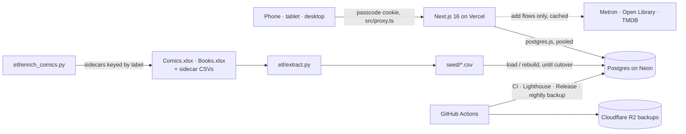

# 02 — Architecture: Ledger

How the Ledger is built: one Postgres database, one Next.js app, two readers'
worth of data model with one reader in it. It replaces `Comics.xlsx` and
`Books.xlsx`. The schema and why it looks the way it does are in
[03-data-model.md](03-data-model.md); the interface rules (dashboards, the
telescope, the plan rail, states) are in [04-design.md](04-design.md); settled
decisions are in [review/decisions.md](review/decisions.md) (`D-n`). When this
file and the code disagree, the code wins (D-1).

## 1. Overview

| | Comics | Books | Watch | Music (Phase 9) |
|---|---|---|---|---|
| Rows migrated | 10,138 issues in 10,761 run placements, 258 runs, 438 prereq edges, 178 editions (2026-09-23 extract) | 1,478 books, 376 authors, 214 series | none — starts empty | none — starts empty |
| Natural model | Directed acyclic graph over runs, ordered list of issues per run | Flat catalog plus per-year status | Three-level hierarchy: franchise → title → season | Three-level hierarchy: artist → album → track |
| What the sheet couldn't do | Transitive prerequisites, fast mobile check-off, per-user progress | Move a title between years without cut-and-paste | Didn't exist. Added Sept 2026 | Didn't exist. Added Oct 2026 (D-75) |

The watchlist was added last and deliberately reuses the comics shape one level
shallower: **franchise → title → season** is **track → run → issue** without the
dependency graph. Same derived-progress pattern, same check-off control, same
detail layout. Nothing new was invented for it.

The comics workbook was already a relational database being emulated with
`COUNTIFS` and `SUMPRODUCT(--ISNUMBER(SEARCH(...)))`. The books workbook was a
single table pivoted across ten year tabs. Both are ordinary schema problems.

Until cutover the workbook is the record and the database is rebuilt from it
and its sidecars (`npm run rebuild`); after it, the database is the record and
`LEDGER_LIVE=true` makes every reload refuse (D-18).

## 2. Stack

| Layer | Choice | Rationale |
|---|---|---|
| Runtime | Next.js 16 App Router, React 19 | Server components render the 641-issue Krakoa run without shipping it to the client twice |
| Database | Postgres 18 (Neon free tier) | Recursive CTEs, `FILTER`, array aggregation — all three are load-bearing here |
| Driver | `postgres.js` with `prepare: false` | Required for Neon's transaction-mode pooler |
| Schema | Drizzle, migrations in git | `drizzle-kit generate` produces reviewable SQL |
| Auth | HMAC-signed cookie, one shared passcode | 40 lines. `currentUserId()` is the only seam the rest of the app knows about |
| Styling | Plain CSS with custom properties | No build step, no utility-class churn, dark mode via `prefers-color-scheme`. The token values come from `design/tokens.css` (D-31, from task 1.8a); Tailwind appears in the design files only as a naming reference (design §4), never as a dependency |
| Hosting | Vercel Hobby; a preview per PR with its own Neon branch | A merge is not a deploy: the hand-run Release workflow is the only path to production (D-18, START-HERE Step 13) |
| Backups | Nightly `pg_dump` to Cloudflare R2 (D-66), restored and checked before upload (D-30) | The workbook stops being a copy at cutover |
| Testing | Vitest on a test database, SQL view tests, Python ETL tests, Playwright and axe (D-72), Lighthouse on every preview | § Testing strategy |
| ETL | Python 3 (`py` on Windows), psql loaders | Reads the workbooks and sidecars; nothing writes back to a workbook |

## 3. Data model

The schema, the decisions behind it (2.1–2.21), the views and the proposed
additions are in [03-data-model.md](03-data-model.md). Two rules shape
everything: catalog and per-user progress are separate tables keyed
`(user_id, entity_id)` (2.1), and nothing derived is stored (2.2).

## 4. Components and boundaries

| Component | Responsibility | Talks to | Location |
|---|---|---|---|
| Pages and layouts | One server component per route; the shell (media bar, rail, sidebar) | `queries.ts` | `src/app/` |
| Route handlers | Writes (progress, add, inbox), search proxies, export, health | `writes.ts`, Metron, Open Library | `src/app/api/` |
| Passcode gate | HMAC-signed cookie; `/login`; the last-medium cookie; `/api/health` is the one route outside it | — | `src/proxy.ts`, `src/lib/auth.ts` |
| Reads | Every read the UI performs, each page's queries in one wave | Postgres views | `src/db/queries.ts` |
| Writes | Every insert and update, one transaction per user action | Postgres | `src/db/writes.ts` |
| Schema and migrations | Drizzle tables; generated SQL migrations, down files for destructive ones | — | `src/db/schema.ts`, `drizzle/` |
| Derived layer | Every view and function: readiness, progress, spans, plan levels | — | `etl/views.sql` |
| Domain logic | The bulk-entry parser, book parsing and review, finish dates, API clients | Metron, Open Library | `src/lib/` |
| Components | Shared UI: sheets, nav, badges, toasts | — | `src/components/` |
| ETL | Extract, volume proposals, Metron enrichment, sidecar checks, load and rebuild | Workbooks, Metron | `etl/` |
| Tooling | Migration and token checks, the perf runner, the e2e runner, release helpers, `task` and `screen` printers | — | `scripts/` |
| Workflows | CI, Lighthouse, Release, nightly backup, Neon preview cleanup | Vercel, Neon, R2 | `.github/workflows/` |
| Export | `GET /api/export`: every table, user-scoped where it has a `user_id` (D-17) | Postgres | `src/db/export-tables.ts` |

## 5. Routes and data access

Every page. One dashboard per medium, with the lists one level down (design §11).

| Route | What it is |
|---|---|
| `/` | Redirect to whichever medium you last touched: the `ledger_medium` cookie, which `src/proxy.ts` writes on a signed-in request under `/comics` or `/books`, never on a `<Link>` prefetch (R1-13, task 1.8c). Comics for a first visit |
| `/comics` | Comics dashboard — the Now hero, the Up next shelf, the telescope, ready runs, the year so far (D-40). Today (task 1.8c): the mid-run and *Start next* lists, with a link to *All runs* |
| `/comics/runs` | The run list, grouped track → block |
| `/comics/tracks` | The tracks index: every track with completion counted in distinct issues, and a *never opened* group; each row links to the run list filtered by track |
| `/comics/status` | In flight · Up next · Done, for runs |
| `/comics/[runId]` | The reading spine. One marker per placement, 3rem rows, optimistic `POST` to `/api/progress/issue`; a range (shift-click, long-press, *Mark everything through here*, *Adopt N prior reads*) goes through the range sheet to `/api/progress/range` (task 1.1) |
| `POST /api/progress/range` | Mark a range of one run's placements read in one statement: `{ runId, placementIds, mode, date?, from?, to? }`, `mode` one of `today · date · spread · none · original`. Placement ids, never sequences (R3-10); every id must be a live placement of `runId` or nothing is written. `ON CONFLICT DO NOTHING`, so a date already recorded is kept and counted as skipped (R3-07). Answers `{ inserted, skipped }`; `DELETE` with `{ runId, placementIds: inserted }` is its undo (task 1.1) |
| `/comics/[runId]/add` | Add issues: search Metron, or type/paste labels, with an insertion preview |
| `/comics/[runId]/[issueId]` | The issue sheet: every run that places the issue, with a read toggle per placement (intercepted route) |
| `/comics/[runId]/path` | *Why blocked?*: the cheapest ordered chain of prerequisite runs (intercepted route) |
| `/comics/releases` | New issues in the series you follow, each offered for adding to its run (task 5.8, D-35) |
| `/comics/editions` | Trades and omnibuses, with *Collected* and *Read* per edition (task 5.10) |
| `/comics/series/[key]` | One volume: every catalog issue of it, the runs that place each with its read state there, and gap stubs (task 5.13) |
| `/books` | Books dashboard — reading now, the plan rail, capacity, the year so far. Until task 2.2 builds it, a redirect to `/books/list` (task 1.8c) |
| `/books/status` | In flight · Up next · Done, for books |
| `/books/list` | Master list: search, filter by status, to-read level, year or genre, series completion |
| `/books/add` | Add books: search Open Library, paste a list, or by hand, with a destination (a quarter or year, On deck, Someday, or a shelf) |
| `/books/plan` | Plan by quarter, full editor |
| `/books/releases` | Books coming out that you want, *Out now* then by month (task 5.7, D-35) |
| `/books/series` | Every series with `read / total` from `series_progress` and its next unread book (task 5.9) |
| `/books/series/[id]` | One series: its books in position order with status and dates, the next unread, gap rows (task 5.9) |
| `/activity` | The reading log: every finished read, by month under year totals, across media (task 6.17) |
| `/settings` | Minutes a day, words a minute — the inputs the capacity engine reads (task 2.0) |
| `/settings/volumes` | The volume map: which volume year a bare series label means, per run or any run (task 3.9) |
| `/watch` | Films and shows, mid-show progress computed from seasons |
| `/watch/status` | In flight · Up next · Done, for films and shows |
| `/watch/list` | Films and shows in one list, with mid-show progress computed from seasons |
| `/watch/franchise/[id]` | Franchises |
| `/watch/person/[id]` | A director's or actor's titles in your watchlist, by role (task 8.10) |
| `/music` | Music dashboard (Phase 9; its layout is 9.0's design) |
| `/music/status` | In flight · Up next · Done, for albums (task 9.6) |
| `/music/artist/[id]` | An artist's discography with status, the song ranking and album favourites (tasks 9.3–9.5) |
| `/inbox` | Quick-capture inbox: book, comic, watch or unsure notes to resolve |
| `/session` | Reading sessions: after-the-fact minutes entry, attach to a book or run; feeds Settings → *Measured from sessions* (the timer is 6.12, D-8) |

**Route handlers** (`src/app/api/`): `/api/progress/{issue,range,book}`,
`/api/runs/[runId]/issues`, `/api/metron/search`, `/api/books`,
`/api/books/bulk`, `/api/books/search`, `/api/shelves`, `/api/inbox`,
`/api/export`, `/api/login`, `/api/health`. A page never links to one with
`<Link>`, because a prefetch runs it (§ Operational posture).

**Auth.** Every route is behind the passcode gate in `src/proxy.ts` except
`/api/health`, which returns no data; nothing else joins it. A stale or garbage
session redirects a page to `/login` and answers a route handler 401.
`currentUserId()` is the only seam the rest of the app knows about (§ If you
add a second reader).

**Validation.** Every write names its rows by id and checks they belong to the
thing being written (a range's placement ids must all be live placements of
its run, or nothing is written). Labels go through the bulk-entry parser, and
AI-proposed or Metron-proposed labels also through a Metron existence check and
an explicit accept (CLAUDE.md).

**External APIs** are called from add flows and backfill only, never to render
a page (§ Metadata sources).

## 6. Feature traceability

MVP and Next features (product § Feature index). Later features are traced
when their milestone is planned; their roadmap entries name their screens and
tables.

| Feature | Screens | Routes and code | Entities |
|---|---|---|---|
| F-01 Private sign-in | — | `/login`, `/api/login`, `src/proxy.ts` | `users`; where failed attempts are counted is 1.11's plan |
| F-02 Workbooks migrated | — | `etl/extract.py`, `etl/load.ps1`, `etl/rebuild.ps1` | every catalog table |
| F-03 Tested, released, backed up | — | `ci.yml`, `release.yml`, `backup.yml`, `/api/export` | all, through `src/db/export-tables.ts` |
| F-04 Fast on a phone | every route | a `loading.tsx` per data route, `lighthouse.yml`, `scripts/perf/` | — |
| F-05 One shell | `home`, `bdash`, `status`, `watchlist` | the root layout, `/`, `/comics`, `/books`, `/watch` | `inbox` (the count) |
| F-06 Mark an issue read | `spine` | `/comics/[runId]`, `POST /api/progress/issue` | `issue_progress`, `run_issues`, `issue_read_runs` |
| F-07 Mark a range | `range`, `batch` | `/api/progress/range` | `issue_progress` |
| F-08 Resume | `spine`, `home` | `/comics`, `/comics/[runId]` | `run_progress` (the pointer is derived) |
| F-09 Add issues by typing | `bulk` | `/comics/[runId]/add`, `/api/runs/[runId]/issues`, `src/lib/bulk-parse.ts` | `issues`, `run_issues`, `volume_rules` |
| F-10 Add from Metron | `addsearch`, `apistates` | `/api/metron/search`, `src/lib/metron.ts` | `issues`, `metron_cache` |
| F-11 Up next queue | `queue`, `home` | `/comics/status?tab=next` | `run_queue`, `run_queue_state` (1.10) |
| F-12 Status screens | `status` | `/comics/status`, `/books/status` | `run_progress`, `run_readiness`, `book_status`, `plan_period` |
| F-13 Volume map | `settings` | `etl/extract.py`, `/settings/volumes` (3.9) | `volume_rules` |
| F-14 No cycles | `path` | `etl/extract.py`'s cycle report (2.11a), `/comics/[runId]/path` | `prereqs`, `run_ancestors()` |
| F-15 Add books | `add`, `blist` | `/books/add`, `/api/books`, `/api/books/bulk`, `/api/books/search` | `books`, `authors`, `book_series`, `open_library_cache` |
| F-16 Inbox | `capture` | `/inbox`, `/api/inbox` | `inbox` |
| F-17 Reading log | `blist` | `/api/progress/book`, `src/lib/finish-date.ts` | `book_status`, `read_events`, `book_reads` |
| F-18 To-read levels | `blist`, `moveplan` | `/books/list` | `reading_plan`, `plan_period`, `to_read_level`, `wishlist` |
| F-19 Clean book catalog | `blist`, `bookdetail` | `etl/extract.py`, Open Library sidecars (1.14), Calibre (1.18) | `books`, `book_series` |
| F-20 Follows | `shelves` | the follow control (1.15), `/books/series` (5.9) | the follow tables (1.15), `series_progress` |
| F-21 Pace engine | `settings`, `session` | `/settings`, `/session` | `reading_settings`, `sessions` (2.1b), the capacity view (2.1) |
| F-22 Books dashboard | `bdash`, `planmonth` | `/books` | `plan_period`, capacity |
| F-23 Plan editing | `plan`, `moveplan`, `rebalance` | `/books/plan` | `reading_plan` |
| F-24 Comics dashboard | `home`, `telescope` | `/comics`, `src/components/telescope/layout.ts` (2.5) | `run_progress`, `block_position`, `block_progress`, `run_read_segments` |
| F-25 Unlock cost | `path`, `runs` | `/comics/[runId]/path` | `run_ancestors()`, `run_unlock_cost`, `run_opens` (2.6) |
| F-26 Run list | `runs` | `/comics/runs` | `run_state`, `block_position` |
| F-27 Completion | — (feel pass) | `/comics/[runId]` | `run_state` |
| F-28 Edit the catalog | `newrun`, `runs`, `spine` | `/comics/runs`, `/comics/[runId]` | `runs`, `run_tracks`, `blocks`, `prereqs` |
| F-29 Detail sheets | `bookdetail`, `issuedetail`, `titledetail` | `/books/[id]`, `/comics/[runId]/[issueId]`, `/watch/[id]` | `books`, `issues`, `issue_read_runs` |
| F-30 Eras and spine v2 | `spine`, `krakoa` | `/comics/[runId]` | `eras`, `run_read_segments` |
| F-31 Ratings and DNF | `top` | `/books/list`, the finish moment | `book_status`, `runs` |
| F-32 Adding at scale | `addsearch`, `bulk` | `/comics/[runId]/add` | `issues`, `run_issues`, `metron_cache` |

## 7. Non-functional requirements

| Area | Requirement |
|---|---|
| Performance | On a throttled phone profile (Lighthouse mobile, Slow 4G, 4× CPU): any tap paints a skeleton within 200 ms, cold or warm; a warm tap between screens shows the page within 1 s. Bytes, requests and CLS per route are gated below |
| Availability | Best effort. Neon's free tier suspends after 5 idle minutes; a cold wake reads as loading, never a frozen page |
| Security | One passcode, HMAC-signed cookie; `/api/health` is the only route outside the gate and returns no data; failed sign-ins slow down (1.11) |
| Data safety | Nightly backups, each restored and checked before upload, the newest 90 kept; `GET /api/export` on demand; soft delete only; production refuses `load` and `rebuild` once live |
| Accessibility | The UX floor (design §10): 4.5:1 text, 3:1 outlines, 44px thumb-bar targets and a 24px floor, real controls with names, axe clean at every width |
| Cost | $0 a month |

### Operational posture

- **Backups.** Nightly `pg_dump` to a Cloudflare R2 bucket via GitHub Actions
  (D-66), the newest 90 kept, each dump restored into a scratch Postgres and
  checked before it is uploaded (D-30), plus `GET /api/export` for a full JSON
  dump on demand.
  Both exist because the workbook is currently your only copy and it shouldn't
  stay that way.
- **Cold starts.** Neon's free tier suspends compute after 5 idle minutes.
  Measured in task 0.9 (2026-10-03, throttled phone profile), the first tap after
  a quiet period took 1.5–6 s longer than a warm one. Every data route paints its
  skeleton at once, so a cold wake reads as loading rather than a frozen page.
  If it still annoys you, the fix is a paid plan with suspend turned off, not an
  architecture change.
- **Performance budget** (task 0.9). The target, on a throttled phone profile
  (Lighthouse mobile, devtools throttling: Slow 4G, 4× CPU): any tap paints a
  skeleton within 200 ms, cold or warm, and a warm tap between screens shows the
  page within 1 s. What holds that, and the test that fails if it slips:
  - **Queries per page, in one wave.** `/comics` 6, `/comics/runs` 2, a run 3,
    `/comics/status` 2, `/books/list` 5, `/inbox` 2, `/watch` none, `/login` none, `/` and `/books` none (redirects), each page's queries started together
    (`test/query-budget.test.ts`, which counts them). A query that must wait on
    another raises a page's waves; raising either number needs a reason here.
    The dashboard (then `/`) and `/books/list` went from 4 to 5 with the inbox
    chip's count (task 1.4b): a separate one-row count in the same wave, rather
    than a join into a list query it has nothing to do with. The dashboard is
    back to 4 since task 1.8c moved *Coming out* (books releases) off it: that
    list is 2.x's `/books/releases`. It is 5 again with the thumb bar (task
    1.8b): `nextUnread`, the hero run's next unread placements, which the mark
    verb and the batch sheet need. It names no run, so it starts in the same wave
    as `inProgressRuns` instead of waiting on it. It is 6 with the Up next shelf
    (task 1.10): `upNext`, the queue's unstarted runs from `run_queue_state`, in
    the same wave; *In Up next · #N* rides on the existing run reads as a join, not
    a query of its own. The shell adds one more to every screen but
    sign-in (task 1.8): the sidebar's and rail's `Inbox (N)` count, a one-row query
    in a `<Suspense>` of its own (`InboxCount`, deduplicated with React's `cache`
    so the rail and the sidebar share one). It is outside each page's budget
    above because it streams: a cold Neon wake delays the number, never the
    page's skeleton.
  - **A view read for one run filters by that run before it aggregates.** No
    catalog-wide CTE, no scan of every issue to describe one run
    (`test/view-plans.test.ts`, which reads the planner's plan). Catalog-wide
    pages (the run list, home) ran in 0.27 s and 0.32 s of database time on
    catalog-sized data when 0.9 closed, down from 5.8 s and 1.6 s; re-measure
    with `EXPLAIN (ANALYZE, BUFFERS)` when a view changes. Not asserted: a
    wall-clock test flakes.
  - **No `<Link>` to a route handler** (`test/no-prefetched-handlers.test.ts`).
    A prefetch runs the handler; the nav's Export link built the 20 MB export
    on every page view until 0.9.
  - **`/comics`, `/comics/runs`, a run and `/books/list` each have a
    `loading.tsx`** (`test/loading-states.test.tsx`). Without one, Next does not
    prefetch a dynamic route and a tap shows nothing until the server finishes.
    `/` has none and needs none: it is a route handler that redirects (task
    1.8c), so nothing renders there. The dashboard sits in a `(dash)` group so
    its boundary stops short of `/comics/[runId]`. A new data route ships with
    its `loading.tsx`.
  - **Bytes, requests, layout shift and accessibility, on every preview** (task
    0.10, `.github/workflows/lighthouse.yml`). Each Vercel preview is measured
    once it deploys: Lighthouse mobile, devtools throttling, three runs per
    route, median, plus 0.9's tap → next-paint runner on the same profile
    (`scripts/perf/`). The job fails only on what holds still between runs: a
    request to a route handler (`/api/*`) during a load or a prefetch, a page
    over the numbers below, CLS of 0.1 or more, or an accessibility score below
    the one recorded here. TTFB, response complete, FCP, LCP, TBT and tap → next
    paint are reported in one PR comment against the last merged PR's run, and
    never gated: a preview's Neon branch is cold or warm by chance. Document +
    RSC counts the HTML and every RSC payload the load fetched (prefetches
    included); Vercel's preview toolbar is left out, since production never
    serves it. The numbers are `scripts/perf/budget.json`
    (`test/perf.test.ts` holds this table to it); each is the median
    measured on 0.10's own preview plus 20%, and the accessibility score is the
    one measured. Raising one needs a reason here. A new top-level screen adds
    its route to `scripts/perf/routes.mjs` and its row here.

    <!-- perf-budget -->
    | Route | Document + RSC bytes | JS bytes | Requests | Accessibility ≥ |
    |---|---|---|---|---|
    | `/login` | 8,000 | 170,000 | 30 | 100 |
    | `/comics` | 28,000 | 170,000 | 35 | 100 |
    | `/comics/runs` | 47,000 | 170,000 | 35 | 100 |
    | `/comics/bendis-disassembled` | 25,000 | 172,000 | 38 | 100 |
    | `/comics/busiek-avengers` | 21,000 | 171,000 | 29 | 100 |
    | `/books/list` | 48,000 | 170,000 | 29 | 100 |
    | `/inbox` | 11,000 | 173,000 | 28 | 100 |
    | `/watch` | 11,000 | 173,000 | 28 | 100 |
    <!-- /perf-budget -->

    Measured on 0.10's preview (2026-10-07, Lighthouse 13.5.0, Chrome 154),
    median of three: document + RSC 6,479 / 38,598 / 20,637 / 16,684 /
    39,279 bytes in the row order above, JS 141,241–142,506 bytes on every
    route (the shared framework chunks), 24–31 requests, accessibility 100 everywhere,
    CLS at most 0.04. The bytes barely move between runs (under 1%), so 20%
    is room for a real change, not noise. `/inbox` (task 1.4b) is set the
    same way from PR #80's preview (2026-10-13, Lighthouse 13.5.0): document +
    RSC 8.7 KB, JS 140.7 KB, 23 requests, accessibility 100, CLS 0.003.
    Task 1.8c moved the run list to `/comics/runs`, which keeps the 47,000 that
    `/comics` was set to (it is the same screen). `/comics` is now the
    dashboard: 28,000 is the median of its first preview's Lighthouse run
    (23,046 bytes, PR #108) plus 20%. `/books` is measured at `/books/list`,
    since Lighthouse sends the session as a `Cookie` header and a redirect
    drops it; it keeps the 48,000 `/books` had. The nav's Books link points at
    `/books/list`, and its Ledger link (`/`, a redirect) is not prefetched: a
    page that prefetched a redirect never reached network idle in the tap
    runner, and made 55 requests against a budget of 35. `/watch` (task 1.8) is
    the shell and an empty slate, so it starts from `/inbox`'s numbers (the same
    weight of page); it is tapped from `/comics` on the media bar's link.
- **Instrumentation.** Deliberately none. This is a single-user CRUD app over
  14,000 rows; adding APM here would be ceremony.

## 8. Testing strategy

| Level | Tool | Covers | Runs in |
|---|---|---|---|
| Unit and integration | Vitest against the test database, one file at a time, `TRUNCATE` in `beforeEach` | Queries, writes, parsers, route handlers, server-rendered markup | `npm test`; `npm run test:all`; CI |
| Views | `etl/test_views.sql` | Every view, on an empty and a loaded database | `npm run test:views` |
| ETL | Python `unittest` (`etl/test_*.py`) | Extract, enrichment, sidecars, label review | `npm run test:etl` |
| Tokens | `scripts/check-tokens.mjs` | Contrast of every text token on every surface, parity with the mockup, elevation order, the 11px floor | `npm run test:tokens` |
| Migrations | `scripts/check-migrations.mjs` | The journal, down files, ungenerated schema changes, edits to applied migrations | `npm run check:migrations` |
| Browser | Playwright and axe in Chromium against `next dev` on the test database (D-72) | Journeys at 360, 390, 412, 768, 1024 and 1280px, light and dark; axe; no horizontal scroll | `npm run test:e2e`; CI |
| Performance | Lighthouse and the tap runner on every preview | Bytes, requests, CLS, accessibility, no route-handler prefetch | `.github/workflows/lighthouse.yml` |

`npm run test:all` runs everything CI's `check` runs. `.claude/kit.json`'s
`verify.full` is the local gate before a push.

**The test database.** Tests read `TEST_DATABASE_URL` and nothing else: a Neon
branch or a local Postgres database named `*_test`. `scripts/lib/testdb.mjs`
refuses when it is unset or names the same host and database as `DATABASE_URL`,
`test/global-setup.ts` runs that check before any test file loads, the guard has
its own test, and there is no fallback (D-11). `npm run test:db:reset` builds it
the way a rebuild does: `drizzle-kit migrate`, then `etl/views.sql`, so a broken
migration cannot ship green.

**Fixtures.** Each test builds its own rows; no acceptance check asserts a
figure copied from a mockup or prose (D-7). The one real-data fixture is the
owner's (D-26): after a rebuild, *Dark Reign: The Cabal (2009) #1* reads as read
in `hickman-ff` and unread in `bendis-dark-reign`.

## 9. Environments

| Environment | Database | Env file or secret | What may touch it |
|---|---|---|---|
| Development | A Neon branch | `.env` `DATABASE_URL` (never production) | `npm run dev`; `rebuild`, `load`, `db:push` and `db:views` after asking; the running app without asking, data left as found |
| Test | A Neon branch or a local `*_test` database | `TEST_DATABASE_URL`, locally and in CI | Tests and anything that truncates, only |
| PR preview | One Neon branch per PR (`preview/<branch>`), deleted on merge | The Vercel and Neon integration | The preview build migrates only its own branch |
| Production | Neon `main` | GitHub secret `DATABASE_URL`; locally only the gitignored `.env.live`, read only with `-EnvFile .env.live` | The Release workflow; before cutover `npm run rebuild -- -EnvFile .env.live` by the owner. `LEDGER_LIVE=true` makes `load` and `rebuild` refuse |

**How merged code goes live.** A merge is not a deploy. The owner runs the
Release workflow (START-HERE Step 13): it refuses unless CI passed on the exact
commit, snapshots the live database when migrating, runs `drizzle-kit migrate`,
re-applies `etl/views.sql`, promotes the build and smoke-tests `/api/health`
(`.github/workflows/release.yml`).

## 10. Metadata sources

The catalog is authored by you; the API fills in what sits *below* the label you
wrote. `runs`, `prereqs`, and the reading orders stay hand-curated because no
database on the internet knows that `Fantastic Four #570-588` plus `FF #1-23`
is one Hickman run with a soft dependency on Secret Warriors. That curation is
the asset.

| Layer | Source | Notes |
|---|---|---|
| Issue records, covers, cover dates, story titles, creators, canonical labels | Metron (`metron_id` on `issues`) | 20 req/min, 5,000/day. Dates, covers and labels come from series issue lists (~1,800 requests); titles and credits need one detail request per issue (~8,100) |
| Comics gap-fill | Comic Vine | 1 req/sec, 200/hour — fallback only |
| Book bibliographic data, page counts, covers | Open Library | no key, CC0 |
| Series position | Hardcover GraphQL | 5,000 req/day free |
| Word counts | Calibre's Count Pages column (data model 2.19, task 1.18); no API | Keep hand-entered values; take Calibre's as `stated` where none is typed; estimate the rest at `pages x 275` and record which is which in `books.word_count_source` |
| Book tags, summaries, series cross-check, read dates | Calibre, the owner's library (data model 2.19, D-73) | Read from a copy of `metadata.db`, never written. Series, index and ISBN fill only where Open Library or Hardcover agree; reads load only once accepted |
| Films and TV shows | TMDB (`titles.tmdb_id`) | Free for non-commercial use, ~40-50 req/sec, covers both media in one API. Requires attribution in the UI |
| Where to watch | TMDB `/watch/providers`, from JustWatch (data model 2.20, D-74) | US only, a dated snapshot refreshed on request. JustWatch's attribution sits beside TMDB's |
| Music: artists, albums, tracks | MusicBrainz, covers from the Cover Art Archive (data model 2.21, D-75) | CC0 core data, 1 req/sec with a real User-Agent. Phase 9 |

Enrichment runs as a background backfill and never overwrites a hand-entered
value. Before cutover it writes the sidecar CSVs in 2.13; after cutover (task
4.1) it writes the database directly under the same rule.

**Add flows are the one place an API is called live** (data model 2.15). TMDB is searched
live because the catalogue is 1.5M+ titles and there is no watch data to seed
from. Metron and Open Library are searched live from *Add issues* and *Add
books*, when you submit a search, so that the thing you add arrives as a real
record with its metadata already on it. No page render ever calls an API.
Responses are cached, and detail pages never re-call.

### Comics

Short answer: **yes for comics, mostly yes for books, no for word counts.**

| Source | Auth | Limits | Verdict |
|---|---|---|---|
| **Metron** | free account, HTTP Basic | 20 req/min, 5,000 req/day per IP | **Use this.** Query issue fields directly in one request; Comic Vine needs a volume lookup first. IDs are stable, and `cv_id`/`gcd_id` filters cross-reference Comic Vine and the Grand Comics Database |
| Comic Vine | free API key | 1 req/sec, 200 req/hour | Fallback for gaps. Much larger catalog, much tighter limits |
| Marvel Developer API | free key | Marvel only | Official, but weaker for run/arc structure than Metron |

Practical shape, as built in tasks 0.6 and 0.7: `etl/enrich_comics.py`
resolves by series name and issue number, caches every response, and writes
sidecar CSVs keyed by label. Series issue lists (~1,800 requests) give
`metron_id`, `cover_date`, `cover_url` and Metron's canonical label, which feeds
a label review. Story titles and credits need one detail request per issue —
about 8,100, so two days at 5,000/day. Credits are stored as `issue_credits`
rows in six roles, and a run's writers and artists are derived from them.
`story_arc` and `page_count` are in the same cached detail pages for later.
Handles 429s and respects `Retry-After`.

What it will **not** do is build your reading orders. Metron knows
`Fantastic Four #570` exists; it does not know that #570-588 plus `FF #1-23`
constitute "Hickman's Fantastic Four" or that it soft-depends on Secret Warriors.
That curation is the actual value in your spreadsheet, and no API has it. So:
**you keep authoring runs and prereqs; the API fills in everything below the
issue label.** Which is the right split — it means adding a run becomes "paste
the series and issue range" and the app resolves 23 issue records for you.

### Books

| Source | Auth | Limits | Best for |
|---|---|---|---|
| **Open Library** | none | courtesy limits, send a real User-Agent | Bibliographic spine: titles, authors, ISBNs, publish years, page counts, covers. CC0 data |
| **Hardcover** | free account, GraphQL | 5,000 req/day free | Series ordering and community tags — the best single source for "book 4 of 7" |
| Google Books | key optional | ~1,000/day per project by default, raisable on request | Descriptions and categories; good fallback |
| ISBNdb | paid | — | Skip |
| **Calibre** (the owner's library) | none: a local `metadata.db`, read from a copy | none | Word counts from the Count Pages plugin, series and index, tags, comments, ISBN, read dates. roadmap 1.18, D-73 |

Use Open Library for the spine and Hardcover for series position, which is data
you currently maintain by hand as `Harry Potter #1`. Calibre's series, index
and ISBN fill only where one of them agrees (D-73).

### Word counts — the honest answer

No general book API exposes word counts. Goodreads never had it, Open Library
and Google Books give page counts, and publishers largely don't publish the
figure. The options:

1. **Estimate from page count.** `pages × 275` is the conventional figure.
   Cheap, automatic, roughly ±15%. Good enough for "is 2027 overcommitted",
   which is a planning question, not an accounting one.
2. **AR BookFinder** (arbookfind.com) publishes real word counts — it's the
   Accelerated Reader database, and it's where numbers like these usually come
   from. No public API, so it's manual lookup.
3. **Keep what you have and estimate the rest.** You already have real counts for
   a large share of the master list. Store a `word_count_source` flag
   (`stated` / `estimated`) so the pace engine can tell you how much of a year's
   projection rests on estimates.

Recommend 3, falling back to 1. Never silently overwrite a hand-entered count
with an estimate.

4. **Calibre's Count Pages column** (2026-10-20). For every book the owner has
   as an ebook, the plugin counts the words in the file itself: a real count,
   loaded as `stated` where the workbook has none (roadmap 1.18). It moves the
   order to 3, then 4, then 1.

### Film and television: TMDB

**TMDB.** One source for films and shows, which decided it — TVmaze is TV-only,
OMDb is thin on television. Free for non-commercial use, ~40–50 requests per
second, hosted posters. Requires a key and **attribution in the UI**.

| Endpoint | Used for |
|---|---|
| `/search/multi` | One search box across films and shows |
| `/movie/{id}`, `/tv/{id}` | Detail. `/tv/{id}` returns the full seasons array in one call |
| `/tv/{id}/season/{n}` | Season overview and episode count, only if the summary array is thin |
| `/collection/{id}` | Film collections — auto-populates franchises |
| `/configuration` | Image base URLs, fetched once and cached |

**One call per show gets you its seasons.** `/tv/{id}` includes a `seasons`
array with number, name, episode count, air date, and poster, so adding a show
populates its whole season list without N further requests.

Unlike Metron and Open Library, TMDB is **called live during search** — the
catalogue is 1.5M+ titles and there's nothing to pre-seed from. Detail is
cached into `titles` and `seasons` on first add.

### Music

| Source | Auth | Limits | Verdict |
|---|---|---|---|
| **MusicBrainz** | none; a real User-Agent | 1 request a second | **Use this** (D-75). CC0 core data. Release groups are albums, recordings are songs |
| Cover Art Archive | none | generous | Album covers by MusicBrainz release id |
| Spotify Web API | app registration | restricted for new apps | Not a catalog source. Links out, if ever, are a later question |

## 11. Walking skeleton

Built as v1 before the kit was adopted (2026-10-08, `docs/kit-adoption.md`):
the run list, the run detail with check-off, books, sign-in, the ETL and its
loaders, CI and the nightly backup. Every layer has been exercised since by
Phase 0 and Phase 1.

## 12. Known gaps

1. **The pace engine is missing.** `To-Read Master List` carried minutes-read-per-day,
   words-per-minute, words-per-week, and quarter projections as formula columns.
   v1 dropped them, which removes the answer to "is next year overcommitted" —
   the reason word counts are tracked at all. `reading_settings` plus a capacity
   view restores it. See product § Beyond the list, item 1.
2. `Ultimate Order` and `Ultimate Collection` (174 + 152 rows) are not migrated
   and are confirmed out of scope.
3. `Reading Orders (old)`, `Master`, `Sheet8` are left behind. `Master` is loaded
   as `editions` but has no page.
4. `edition_issues` is declared conceptually but not built, so "which trade
   collects this issue" isn't answerable yet.
5. ~~`book_status.finished_year` is year-granular.~~ Done in task 1.5: a book's
   finish is a date with its precision (`finished_on`), every read is a
   `read_events` row, and the year is derived (D-21). Comic reads are not logged
   in `read_events` yet.
6. `external_lists` entries are unresolved text until you link them to
   `books.id`. `wishlist` is promoted into Someday by task 1.4d (D-39).
7. No editing UI. Reads are complete; writes are limited to issue check-off and
   book status.
8. The watchlist is entirely unbuilt — `titles`, `seasons`, `franchises`, and
   their status and event tables are drafted in data model §4.2 but no
   migration exists yet. It has no data to migrate, so it is the one feature
   that starts from an empty table rather than a spreadsheet.
9. Cross-media franchises are hand-curated. TMDB collections cover film series
   only; nothing in any public API links a film franchise to its television
   entries.
10. Music is unbuilt (Phase 9, D-75), and like the watchlist it starts empty.
    Its design (9.0) comes before its schema, because a fourth medium changes
    the phone media bar every screen shares.
11. Reading sources and outside ratings (Marvel Unlimited, League of Comic
    Geeks) have no public API. They are parked in roadmap *Later*, each behind an
    open question.

## 13. Risks

| Risk | Impact | Mitigation |
|---|---|---|
| Cutting over before Phase 1 is done | Adding is slower than the sheet, and use drifts back to it | Cutover waits for M1–M9 (product § Success at MVP) |
| Reading history lost before it is logged | A second read overwrites the first; a start date not captured is gone | `read_events` landed with 1.5; start dates (1.17) land before cutover |
| A deploy that migrates on its own | No undo on live data | Release is the only path to production; `LEDGER_LIVE` makes reloads refuse (D-18) |
| Prerequisite cycles (a 98-run strongly connected component) | Readiness and unlock cost are meaningless inside a cycle | 2.11a reports cycles for review before cutover; `run_ancestors()` is cycle-safe with a 48-level cap (D-6) |
| AI-proposed labels | A confident, wrong issue number in a curated catalog | The parser, a Metron existence check and an explicit accept; Phase 7 only after Phase 4 |
| Metron's limits (20 a minute, 5,000 a day) | Slow backfill, a stalled add | Cached responses, `Retry-After` honoured, sidecars keyed by label |
| Neon cold starts | The first tap after idle is 1.5–6 s slower | A skeleton at once on every data route (0.9); a paid plan if it still annoys |
| Design drift between mockup, blueprint and feel pass | Rework | design §2 says which file wins; a task that changes a screen redraws its mockup frame (standing rule 6) |

## 14. If you add a second reader

1. `INSERT INTO users (id, name) VALUES ('…', '…')`.
2. Swap the body of `currentUserId()` for a real provider. Everything downstream
   already takes `userId` as a parameter.
3. The views already `CROSS JOIN users`, so progress, readiness, and rollups
   become per-person with no query changes.
