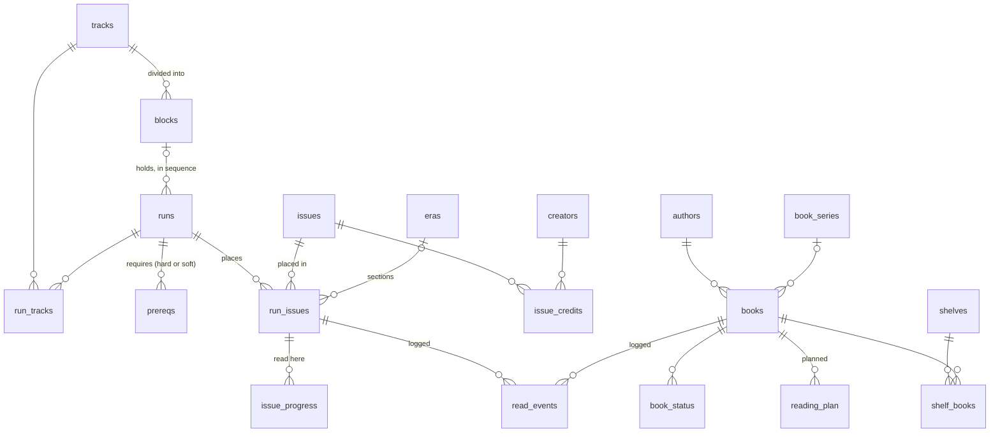

# 03 — Data model: Ledger

What is stored, what is derived, and why the schema looks the way it does.
**`src/db/schema.ts` and `etl/views.sql` win over this file** (D-1): they are
what runs. This file explains them and lists what is proposed and not built.
The full entity diagrams are [DIAGRAMS.md](DIAGRAMS.md) §1 (comics), §2
(books), §3 (the derived layer) and §8 (the watchlist draft). The data rules a
reviewer checks are in `.claude/rules/schema.md`.

## 1. Overview

**Catalog, progress, log, derived.** Each medium has a catalog of what exists,
per-user progress keyed `(user_id, entity_id)`, an append-only log of reads, and
views over all three. Comics read state keys on the placement, never the issue
(2.14). Nothing derived is stored (2.2): counts, percentages, rollups, states,
spans, credit lines and finish or plan years are views. Soft delete only: every
read filters `deleted_at IS NULL`, and removing a placement soft-deletes it.

| Group | Tables | Notes |
|---|---|---|
| Comics catalog | `tracks`, `blocks`, `runs`, `run_tracks`, `prereqs`, `events`, `event_runs`, `editions`, `issues`, `run_issues`, `eras`, `creators`, `issue_credits`, `volume_rules` | Run ids are as the owner wrote them (2.5); an issue id is a slug of its label (2.11) |
| Books catalog | `books`, `authors`, `book_series`, `releases`, `wishlist`, `external_lists` | `wishlist` and `external_lists` keep raw text until resolved (2.7) |
| Per user | `issue_progress` (per placement), `edition_progress`, `book_status`, `reading_plan`, `reading_settings`, `shelves`, `shelf_books`, `inbox` | Keyed `(user_id, entity_id)` (2.1) |
| Logs | `read_events` | Append-only; a reread is a new row with `reread_of` (1.5) |
| Caches | `metron_cache`, `open_library_cache` | Rebuildable API responses |
| Users | `users` | One row today (§ If you add a second reader, in the architecture) |

32 tables in `src/db/schema.ts`, migrations `0000` to `0013`. Count them again
from the schema, not from here.



## 2. Decisions

**2.1 Catalog and progress are separate tables.** `issues` holds what exists;
`issue_progress` holds what you've read, and where you read it (2.14). Every
progress table carries `user_id` and is keyed on `(user_id, entity_id)` — for
comics the entity is the placement, not the issue. You are the only row in `users` today.
Adding your wife later is an `INSERT`, not a migration — this is the single most
expensive thing to retrofit and the cheapest thing to build in up front.

**2.2 Nothing derived is stored.** Every formula column in `RUNS` — `Readiness`,
`Hard Left`, `Soft Left`, `Unlocks`, `Completed`, `% Done`, `Status`, `In Sheet` —
and the entire `TRACKS`, `DASHBOARD`, and `NOW` tabs are Postgres views in
`etl/views.sql`. At 10k issues the whole rollup runs in single-digit
milliseconds, so there is no cache to invalidate and no state to drift.

| Sheet artifact | Replacement |
|---|---|
| `RUNS!Readiness` | `run_readiness` view |
| `RUNS!% Done`, `Completed`, `Left` | `run_progress` view, over the run's own placements (2.14) |
| `Reading Orders!Completed` | `issue_progress`, one row per read placement — per run, as the sheet had it |
| `RUNS!Series (and Issues)`, `Start Year`, `End Year` | `run_span` view — series text from issue labels, years from `issues.cover_date`. The typed columns had drifted from the reading orders in 212 of 259 runs |
| `RUNS!Writer`, `Artists` | `run_credit_line` view over `issue_credits` (2.11). 157 of 259 runs had no artist typed |
| `TRACKS` tab | `track_progress` view (distinct issues via `track_issue_counts`) |
| `DASHBOARD` ready-to-read query | `readyToRead()` in `src/db/queries.ts` |
| `CLOSURE` tab + Apps Script (removed July 2026) | `run_ancestors(run_id)` — a recursive CTE, cycle-safe, 48-level depth cap |
| `Read 20XX` tabs | `books_by_year` view: reads per year, from `book_reads` (`read_events`, plus workbook reads with no log row) by `extract(year FROM finished_on)` (D-21, D-65) |
| `To-Read 20XX` tabs | Tabs before 2028: `reading_plan.period`, a bare year (`'2027'`), written only with `extract.py --with-plan`: the plan starts empty (D-13, task 1.7). Later tabs load nothing; their titles go to `seed/workbook_plans.csv`, which is not loaded (D-70) |
| `Series!Percent Read` | `series_progress` view |
| `Reading Orders!Track`, `Run Title` | dropped — they were lookups; the join replaces them |

**2.3 The transitive closure you abandoned is now free.** `run_ancestors()`
walks the prereq graph to any depth, collapsing a chain to `hard` only when
every link in it is hard. The run detail page uses it directly, so "read these
first" shows the real chain rather than the one-hop neighbours.

**2.4 Tracks are a join table, not a comma-delimited string.** `RUNS!Track`
held `"Avengers, Spider-Man"` and the sheet searched it with string matching.
`run_tracks` makes it a proper many-to-many, which is why track filtering is an
index lookup instead of a scan over 258 concatenated strings.

**2.5 Run IDs stay exactly as you wrote them.** `hickman-ff`, `claremont-xmen`,
`pad-hulk` become the primary keys. Your `PREREQS` tab allows forward-declared
IDs that don't exist in `RUNS` yet; the ETL materializes those as rows with
`placeholder = true` rather than dropping the edge, and they're hidden from the
run list until you fill them in.

**2.5b Three media types, one set of patterns.** Comics, books, and film/TV each
get a catalog table, a per-user status table, and an append-only event log
(`read_events`, `watch_events`). Progress that can be computed is computed:
`run_progress` over issues, `show_progress` over seasons, `franchise_progress`
over both films and shows. A show's state is never written to `title_status` —
it is a view over `season_status`, for exactly the reason run completion is a
view over `issue_progress`. The one exception is **dropped**: abandoning a show
is a decision, not a consequence of seasons, so a `title_status` row with
`kind = 'tv'` and `status = 'dropped'` is allowed and `show_progress` reads it
first. `show_progress.state` is therefore
`unknown | to_watch | watching | watched | dropped`, and no other show-level
status is ever written. *(2.20 adds a derived `caught_up` for a returning show
with every season watched, and lets a show's row carry a rating with a NULL
status. Music, Phase 9, is a fourth medium on the same pattern: 2.21.)*

**2.5c Seasons are tracked; episodes are not.** A show has 2–10 seasons. Episode
tracking would add roughly two orders of magnitude of rows to buy granularity
nobody asked for, and the comics side already demonstrates what 10,000-odd
check-offs feels like. `watch_events` takes either a `title_id` or a
`season_id`, so episode support is an additive change if that judgment turns out
wrong.

**2.5d Franchises and shelves are different things.** A franchise is a fact
about the work — Andor is Star Wars regardless of opinion — and is partly
machine-derived: TMDB films carry `belongs_to_collection`, which seeds
`franchises` automatically. A shelf is the user's own grouping. They stay
separate tables because merging them would make an imported fact and a personal
judgment indistinguishable. `franchises.parent_id` allows exactly one level of
nesting; deeper is a tree nobody needs.

**2.5e Shelves are typed, not polymorphic.** `shelves.kind` is `books` or
`titles`, with `shelf_books` and `shelf_titles` each carrying a real foreign
key. An earlier draft used one table with nullable `book_id`/`run_id` columns and
a `num_nonnulls` check; that was removed because a polymorphic foreign key
cannot be enforced by the database.

**2.6 Editions are separate from issues.** The `Master` tab tracks what you own
in print — 178 trades and omnibuses with `Collected` and `Read` flags that don't
line up with issue-level progress. Modeling `edition_issues` as a join is left
for later; the text field is preserved verbatim so nothing is lost.

**2.7 Books that aren't clean records stay as text.** The old `To-Read` tab mixes
titles, series-plus-author strings, and `Top` markers. 497 of those land in
`wishlist` with `raw_entry` intact and a nullable `book_id`, so nothing is lost
before they are cleaned. They are promoted once, through 1.4's paste-a-list
review (task 1.4d, D-39), after the final load: each line becomes a Someday book
(2.9) or is dismissed, and the table goes once it is empty.
The 534 BookTube entries live in `external_lists` the same way.

**2.8 Blocks are a table, not a number.** A track is divided into numbered
blocks, and `runs.sequence` is a run's position inside one. The numbering is
scoped per track — `avengers` block 1 and `x-men` block 1 are different blocks —
so a bare `runs.block` integer could not say which block a run was in. `blocks`
carries `(track_id, number)` with a nullable `name`, and `runs.block_id` is a
nullable FK to it. Nine runs have no block and load as NULL. The ordinals the
dashboard needs ("run 3 of 5 in block 2 of 7") are computed in the
`block_position` view rather than stored.

**2.9 A plan entry has one period column, and the year is a substring of it.**
`reading_plan` originally carried `planned_year` and `planned_quarter` side by
side (and a `planned_month` was drafted), which allows a row to claim 2027 and
Q1 2028 at the same time. It also has no way to say "this is a 2027 book and I have not
decided when" without that being indistinguishable from a data-entry gap — and
the workbook's To-Read tabs held 100-odd rows in exactly that state (the plan itself now starts empty and is built in the app, R0-04). One column solves both:

```
reading_plan.period text NOT NULL
  CHECK (period ~ '^[0-9]{4}(-Q[1-4])?$' OR period = 'on_deck')
```

`2027-Q1` is a quartered book, `2027` a book committed to the year with no
quarter yet, and `on_deck` a book with no year that is next in line. The year
is `left(period, 4)`, so a year is literally what its quarters roll up to;
nothing can disagree with itself. The `plan_period` view exposes `year`,
`quarter` and `level` so no caller parses the string. **There are no months**
(D-38): a quarter is the finest grain the plan has, so there is no month period,
month rail or monthly capacity, and `reading_settings.plan_granularity` goes.
Migration is mechanical: compose the two columns into one (task 1.7).

The dashboard depends on this. The plan rail draws four quarter columns plus a
fifth lane for `period = year`, and the whole point of the fifth lane is that
those books are visibly in the year and visibly not in the plan.

**A to-read book sits at one of four levels** (D-37, task 1.7):

| Level | Stored as | Ordered | Counts against capacity |
|---|---|---|---|
| Quarter | `period = '2027-Q1'` | yes | that quarter, and its year |
| Year | `period = '2027'` | no | that year |
| On deck | `period = 'on_deck'` | no | nothing |
| Someday | no plan row | no | nothing |

The first three are plan rows. Someday is derived — every `to_read` book with no
plan row — so it never needs writing and cannot disagree with the plan; the
`to_read_level` view names each book's level. A book enters at any level from
the add sheet (2.15) and moves between levels through one picker (task 2.3);
leaving the plan means moving to Someday.

**Only quarters are ordered.** A quarter says *when*; with eight books in it,
*which first* is the question you actually ask. So a quarter carries the comics
queue's shape (2.16):

```
reading_plan.ordinal int   -- NULL exactly when the period is not a quarter
  UNIQUE (user_id, period, ordinal) DEFERRABLE INITIALLY DEFERRED
```

Ordinals are contiguous from 1 within each quarter, and a year reads as its four
quarters in order. Like the queue's order, it is authored, so it is stored: a
book joins the end of the quarter it is placed in, leaving closes the gap, and a
reorder rewrites the quarter in one transaction. The rail stacks a quarter's
blocks in this order from the foot of the column, so the books that cross the
capacity rule are always the ones you ranked last, and the dashboard's *first
Q-current book* is ordinal 1, not an accident of insertion. The year lane and
On deck are unordered on purpose: they hold books you have not decided about
yet, and ranking them would be the decision those levels exist to put off. The
queue stays period-free (2.16); the plan gains an order but keeps its periods.

**2.10 An era is to a run what a block is to a track.** `design/mockups.html`
sections the reading spine into named eras — "Second Genesis & Phoenix 38/38",
"Days of Future Past 4/22" — each with its own count and bar. Nothing in the
data model backs that: the workbook has no era column and `etl/extract.py` never
mentions one, so the era bands are currently a drawing.

They get the same shape as blocks, for the same reason 2.8 gives. `eras`
carries `(run_id, ordinal, name)` and `run_issues.era_id` is a nullable FK —
on the placement, not the issue, because an era is a stretch of one run's
reading order and the same issue can sit in a different era of another run.
`era_progress` mirrors `block_progress` so the run detail can treat them
interchangeably. The alternative — a bare `era` text column — cannot
order eras, cannot rename one without touching every issue in it, and gives no
place to hang a per-era note later.

Two deliberate asymmetries with blocks. A block is numbered with an optional
name, because a block is a *position* in a track and the number is the fact; an
era is named, because an era is a *story* and the name is the fact. And eras
are optional in a way blocks are not: all 258 runs have blocks, far fewer will
ever be worth sectioning. A run with no eras renders a flat spine, which is
what every run does today.

Eras come from nowhere at migration time. They are typed by hand on the run
detail, and task 7.3 — which already reviews a run's reading order against
Metron — is the natural place to propose them.

**2.11 One issue row per comic; runs place issues.** The workbook listed an
issue once per run that read it: 10,835 rows for 10,285 distinct labels, with
426 raw labels in two to four runs (the Fear Itself core issues sit in four).
Stored that way, a crossover counted three times in its track and credits would
have been copied onto every copy. So `issues` is the comic — label (unique),
cover date, story title, cover URL, Metron id — and `run_issues(id, run_id,
sequence, issue_id, type, notes)` is where it sits in a run. `type` and `notes`
stay on the placement because 213 labels are core in one run and optional in
another.

`issue_credits` keys on `issues.id`. Read state does **not** — it keys on the
placement (2.14). Track, block and catalog totals count distinct issues
(`track_issue_counts`, `block_issue_counts`, `catalogTotals()`), never a sum of
run totals. A run holds an issue at most once — `run_issues` is UNIQUE on
`(run_id, issue_id)` — so a run's placement count *is* its distinct-issue count
(D-12, D-19). A label repeated inside one run is dropped by extract and reported
(`repeat placement dropped`); a planned reread is a note on the placement.

*Revised Sept 2026.* This section originally also argued that reading
`Fear Itself #4` in one run should mark it read in the other three. That was
reversed by 2.14: read state is per run.

The issue id is a slug of its label (`fantastic-four-1961-570`), not the old
`run#sequence`. Inserting an issue into a reading order no longer renumbers
every later id, which removes the one-way-door problem from the pre-build review.

**2.12 Credits are rows, and a run's credit line is derived.** `creators(id,
name, metron_id)` and `issue_credits(issue_id, creator_id, role, source)`, with
Metron's many role names collapsed to six: writer, artist, inker, colorist,
letterer, cover. A `text[]` of names on `issues` — the earlier plan — could not
say who drew versus who wrote, could not filter the catalog by creator, and
could not merge "J. Hickman" with "Jonathan Hickman". The creator id is a slug
of the name, so a hand-entered credit and Metron's land on the same row.

`runs.writer` and `runs.artists` are gone. The `run_credit_line` view lists the
writers and artists on at least a quarter of a run's credited issues, most
issues first, three at most. There is deliberately no hand-typed fallback: a
wrong credit line is fixed by fixing the issues' credits, so the run and its
issues can never disagree. The workbook's typed values survive only in
`seed/workbook_run_fields.csv`, and extract flags each run whose typed writer
isn't among its credits.

**2.13 Enrichment writes sidecar CSVs keyed by label, and labels change only by
accept.** Until cutover the workbook is the truth and the database is rebuilt
from it, so Metron's output can't live only in the database — it would be lost
on every rebuild. It lives in files beside `volume_map.csv`: `cover_dates.csv`,
`issue_details.csv`, `issue_credits.csv` and `label_review.csv`. They are keyed
by label because the label is what the workbook and Metron share; ids are
derived from labels at extract time.

Every value carries its source, `metron` or `hand`, and the scripts never
replace a `hand` value. For credits the unit of ownership is `(label, role)`:
one hand writer row means the writers for that issue are yours.

Enrich compares every matched label with Metron's canonical label and proposes
the difference in `label_review.csv`, by category (`year_added`,
`oneshot_number`, `name_style`, `subtitle`, `wrong_volume`). Extract applies a
rename only on an explicit `accept`, the same rule as AI-proposed labels. When a
rename is accepted, the next enrich run moves every sidecar row from the old
label to the new one, hand rows included, so accepting a fix never orphans a
date you typed. Nothing writes back to the workbook.

**2.14 Read state belongs to the placement, not the issue.** *Sept 2026,
reverses part of 2.11.* Reading `Fear Itself #4` as part of the event does not
mean you have read it as part of Journey into Mystery's run. You read it in a
place in an order, and the next time it turns up in a different run you may
want to reread it there or skip it. That is your decision to make on that run.
Marking it read everywhere at once took the decision away. So a checkmark
belongs to a placement:

```
run_issues.id   serial PRIMARY KEY          -- the placement; stable when the order changes
                UNIQUE (run_id, sequence) DEFERRABLE INITIALLY DEFERRED   -- was the primary key
                UNIQUE (run_id, issue_id)   -- one placement per run (D-19)
issue_progress(user_id, placement_id → run_issues.id ON DELETE CASCADE,
               completed_at, completed_at_precision)  PRIMARY KEY (user_id, placement_id)
```

Landed in migration `0007_placement_progress` (task 0.8a). The sequence
constraint is deferred so one `UPDATE … SET sequence = sequence + 1` can shift a
run past an insert (R0-15); the precision pair is 2.17's, unchanged.

The key is a surrogate, not `(run_id, sequence)`, because inserting an issue
into a reading order renumbers every later sequence. `(run_id, issue_id)` is
UNIQUE as well (migration `0004`, D-12): this section once argued it could not
be, because labels repeated inside a run and a planned reread seemed legitimate.
The repeats turned out to be a block entered twice, and the owner decided a
reread inside a run is a note, not a second row (D-19). The surrogate stays the
key because it is what `issue_progress` points at.

What changes downstream:

- **`run_progress` and readiness count the run's own placements.** A
  prerequisite run is finished when *its* placements are read. Reading the same
  issues inside some other run does not finish it.
- **Block, track and catalog rollups still count distinct issues.** An issue
  counts as read in a scope when any of its placements inside that scope is
  read. So a crossover sitting in two runs of the X-Men track counts once, and
  counts as read once either run has it checked. Never SUM run totals.
- **"You've read this before" is derived.** The `issue_read_runs` view returns,
  per user and issue, the runs in which a placement of it is read, plus the
  earliest `completed_at`. The spine uses it to badge a row as *read in Hickman
  — FF*, whether that row is read in this run or not. The issue detail lists
  every run that places the issue and its read state in each. The view is a
  hint. It never checks a box.
- **Nothing propagates.** Marking a placement read writes one row. Range marks,
  undo and the thumb bar act on placements in the current run only.
- **`read_events` carries `placement_id` for comics** (task 1.5). Reading the
  same comic in a second run is a first read *of that placement*. `reread_of`
  links repeat reads of one placement. Stats that count comics read count
  `DISTINCT issue_id`.
- **The workbook already worked this way.** `Completed` is a column on each
  `Reading Orders` row, so extract loads each row's own value. Only 1 of the 76
  completed rows sits on a shared label, and the "completed in one run, not
  another" flag is removed because that case is no longer an inconsistency.

Credits, cover dates, story titles and labels stay on `issues`. They are facts
about the comic. Only the reading is about the placement.

**2.15 Adding starts from a search or a line of text, and always ends in a
real row.** *Sept 2026.* Every add flow offers the same two paths: search an
API, or type it yourself. Both write a real catalog row before they write
anything that points at it:

| Adding | Search path | Freeform path | Then writes |
|---|---|---|---|
| An issue to a run | Your catalog first, then Metron live: series + number, cover and cover date on the result | A label, or many, through the bulk-entry parser (task 1.3) | `issues` (new label) or reuse of the existing row, then a `run_issues` placement |
| A book to a to-read level (a quarter or year, On deck, Someday) or a shelf | Your library first, then Open Library live | Title and author required, series, position, pages and words optional | `books` (plus `authors` / `book_series` if new), then `shelf_books`, `book_status` or `reading_plan` |
| A film or show | TMDB live (unchanged, 2.5b) | — none (D-28): when TMDB fails or finds nothing, *Save to inbox* keeps the query as a Watch capture note | `titles` / `seasons`, then status |

An existing row is always reused. A search result that is already in your
catalog shows up as your row ("in 3 runs", "on 2 shelves"), not as a second
copy. A Metron result writes `metron_id`, `cover_date` and `cover_url` with
source `metron`, and its label is normalised to the bulk-entry grammar before
insert. A freeform issue or book is written with nothing but what you typed.
Backfill (task 4.1 for issues, 4.2 for books) fills in the rest later, and
never overwrites what you typed.

This narrows a rule rather than dropping it. **Metron and Open Library are now
called live, but only from an add flow, which is an action you started**, and
never to render a page. A search runs when you submit it, not on every
keystroke. At 20 requests a minute, Metron is plenty for one person adding
issues. Responses are cached like the backfill's. Hardcover stays backfill-only.
The AI rule is unaffected: tapping *Add* on a Metron result is an explicit
accept of a label Metron says exists, and a freeform line is your own label,
not a model's.

**A quick-capture note is the way into these paths, not a third one** (task
1.4b, D-64). `inbox(id, user_id, raw_text, kind, created_at, resolved_at,
book_id, run_id)` holds a thought with nothing required but its text; `kind`
is `books`, `comics`, `watch`, or NULL for *Unsure*. **Resolve** opens the add
flow the kind names with the text in its search (`?q=`) and the note in tow
(`?note=`); the add that completes links the `books` or `runs` row it wrote and
stamps `resolved_at` in its own transaction, and its undo reopens the note. A
Watch note resolves into `/watch/add` (8.2) and links nothing yet. A note links
at most one row, and only once resolved (CHECKs in migration 0010).

**2.16 Comics get an Up next queue: one ordered list, no dates.** *Sept 2026.*
Books have a plan with periods because word counts make time budgeting
meaningful. Comics need something looser: runs you want to read next, in the
order you want to read them. You can add to it, reorder it and remove from it.
It has no years, quarters or capacity.

```
run_queue(user_id → users, run_id → runs, ordinal int NOT NULL,
          added_at timestamptz NOT NULL DEFAULT now())
  PRIMARY KEY (user_id, run_id)
  UNIQUE (user_id, ordinal) DEFERRABLE INITIALLY DEFERRED
```

- **The order is authored, so it is stored.** Like a why, the order is your
  judgement and nothing derives it. `ordinal` is contiguous from 1. A reorder
  or removal rewrites the ordinals in one transaction, which is why the unique
  constraint is deferrable. At a list of dozens, renumbering is cheaper than
  fractional keys.
- **Membership is stored; state is derived.** A queued run keeps its row
  when you start it. *Up next* shows only queued runs with nothing read, so a
  started run moves to *In flight* and a finished run to *Done*, both through
  `run_progress`. Nothing removes a row automatically. Unmarking a run back to
  zero puts it back in its old place. The row goes only when you remove it.
- **Anything real can be queued, blocked runs included.** A blocked run shows
  its amber *N runs first* badge, because wanting to read it next is legitimate
  and the badge says what that costs. Placeholder and soft-deleted runs can't
  be queued.
- **It is not a shelf.** Shelves hold books or titles, never runs (2.5e). A
  shelf is a named grouping you can have many of; the queue is one ordered list
  per user.
- **Removing is a hard delete of the queue row**, with an undo toast (task
  1.2). Soft delete protects the catalog; a queue row is a note to yourself.

`run_queue_state` joins the queue to `run_progress` and `run_readiness` so
the dashboard and the status screen read one ordered row set with state and
badges, and nothing is computed in the app.

**Table count:** 33 in `src/db/schema.ts` today (migrations through `0014`, which added `run_queue`); the proposed tables are in §4.

**2.17 A date is stored with its precision.** *Sept 2026, D-R3-1 (closes
R1-04, R3-03, R2-10).* The range sheet draws *No date*, 1.5 promises
"approximate", and the workbook's 76 reads and ~1,290 book years carry no day at
all. Storing `now()` for those would date reading history to the day of a
backfill, permanently and undetectably. So one rule, applied to three tables:

```
issue_progress.completed_at        timestamptz NULL, completed_at_precision  text NOT NULL DEFAULT 'exact'
book_status.finished_on            date        NULL, finished_on_precision   text NOT NULL DEFAULT 'none'
read_events.finished_on            date        NULL, finished_on_precision   text NOT NULL DEFAULT 'exact'   (1.5)
  precision IN ('exact','approximate','none')  and  (date IS NULL) = (precision = 'none')
```

- `none` is a read with no known date: it counts as read, is excluded from
  pace maths, and sorts **last** wherever finish dates are ordered (`NULLS
  LAST`; Postgres puts NULLs first in a `DESC` sort). `approximate` is a real date the owner has said is a guess (a
  *Spread* range, a book known only by its year, stored as that year's July 1).
  `exact` is a date entered or recorded as it happened.
- The pairing CHECK is the point: a date and its precision cannot disagree, and
  there is no state where a NULL date reads as exact.
- The ETL writes `none` and a blank date for every workbook read, and never lets
  a column default stamp the load time. Anything that computes pace or "read ·
  Sep 2026" filters `precision <> 'none'` or reads a NULL as unknown.
- Landed in migration 0004 for `issue_progress` and `book_status`, and in 0011
  (task 1.5) for `read_events`.
- A book's finish **year** is not a second column. Migration 0011 (task 1.5)
  dropped `book_status.finished_year`, after backfilling each year to its July
  1st, `approximate`; every reader derives the year from `finished_on` (D-21),
  so a year and a date can never disagree.
- Dates live in `America/New_York` (task 1.16, D-67). A calendar day in
  `completed_at` is stored as its Eastern midnight (migration 0012 moved the
  older UTC midnights), *today* is the Eastern day on the server and in the
  browser (`src/lib/finish-date.ts`), and every date is shown in Eastern. The
  two `date` columns carry no zone; only the *today* that writes them moved.

**2.18 A read has a start, stored for books and derived for runs.** *Oct 2026,
backlog intake; task 1.17; proposed, settled at its plan gate.* A book's start
is a fact nothing else records: setting *Reading* is the only moment it is
known. So it is stored with its precision under 2.17's rule, on `book_status`
(the read in progress) and on `read_events` (each finished read, so a reread
keeps its own start):

```
book_status.started_on   date NULL, started_on_precision  text NOT NULL DEFAULT 'none'
read_events.started_on   date NULL, started_on_precision  text NOT NULL DEFAULT 'none'
  same CHECK pair as the finish; a start after the finish is refused by the write path
```

A run's start is not a new fact. It is the earliest dated read of its own
placements, so `run_state.started_at` sits beside `finished_at` as a view
column. Days taken, for either, is computed in the query. Undated (`none`)
reads count toward neither.

**2.19 Calibre is a metadata source, read the way the workbook is.** *Oct
2026, D-73; task 1.18.* The owner's Calibre library has word counts no API
offers (architecture § Metadata sources). It is read like the workbook: `etl/calibre.py`
opens a copy of `metadata.db` read-only, matches on title and author (1.13's
rule), and writes sidecars that extract folds in, so the data survives every
re-extract and nothing writes to Calibre. *Amended by D-87 (2026-10-27):*
Calibre is the source of truth for a book's data and its reads, because the
owner edits nothing else. Its word count, series and index replace the
workbook's, a series Open Library contradicts still fills, and its reads load as
it has them; what disagrees (the workbook's value, Open Library's series, a
second read) is reported, never silently dropped. Only a near spelling waits on
a decision. Tags, comments and the ISBN load nothing until their columns are
approved (D-88). After cutover, 4.4 carries the same rules into the app.

**2.20 Watch metadata: credits are rows, counts are derived, availability is
dated.** *Oct 2026, backlog intake; D-74; tasks 8.1, 8.9, 8.10; amends the
data model §4.2 draft before anything is built.*
- People are rows (`people`, `title_credits`), for 2.12's reason: a director's
  page and a cast filter are joins, and one person is one row however many
  titles credit them.
- A show's season and episode totals are counts over `seasons`, in
  `show_progress`. The draft's `titles.season_count` is gone (2.2).
- Network or streamer and studio are short vocabularies, so they are `text[]`
  columns like `genres`.
- Where to watch changes monthly, so it is a dated snapshot (`title_providers`
  with `fetched_at`). It is refreshed only when asked, never on a page render
  (2.15), and always shown with its date.
- *Waiting for a new season* is `show_progress.state = 'caught_up'`, derived
  from the seasons and `titles.tmdb_status`. It is a sixth state beside
  2.5b's five, and is never written.
- A show's `title_status` row may hold a rating and notes with a NULL status.
  The only show-level status written stays `dropped` (2.5b).

**2.21 Music is the watch shape again.** *Oct 2026, D-75; Phase 9.* Artist →
album → track mirrors franchise → title → season, which mirrors track → run →
issue. It reuses each pattern: a catalog table per level from one API
(MusicBrainz), per-user status keyed `(user_id, entity_id)`, an append-only
`listen_events` log, follows per artist on D-43's model, and progress in
views. The one authored order is the song ranking (`song_rankings`,
contiguous ordinals, like 2.16's queue). Album favourites are a view over it.
A song is a MusicBrainz recording, ranked once however many albums carry it.
An album's tracklist comes from one canonical release, the earliest official
one, so editions and remasters don't multiply songs.

## 3. Views

Every view and function in `etl/views.sql`, applied after every migration (a
rebuild, the test reset, a preview build, Release). A view read for one run
filters by that run before it aggregates (architecture § Operational posture).

| View | What it derives |
|---|---|
| `live_run_issues` | The placements that count: neither the placement nor its issue soft-deleted. Every view that reads `run_issues` reads this |
| `run_progress` | Per run and user: read and total placements, the run's own only (2.14). Replaces `RUNS!Completed`, `Left`, `% Done` |
| `run_span` | A run's series-and-issues text and its publication years, from its issues (0.6) |
| `run_readiness` | Direct prerequisites: hard and soft left, what a run unlocks |
| `run_state` | The five states the UI draws: `blocked`, `ready_hard`, `ready_all`, `reading`, `read` (design §11) |
| `run_read_segments` | Read state as run-length segments, for the telescope's run rail |
| `run_ancestors(run_id)` | Every run that must come before a run, at any depth; cycle-safe, capped at 48 levels (D-6) |
| `event_tracks` | An event's tracks, through its runs |
| `track_issue_counts`, `block_issue_counts` | Distinct issues and distinct read issues per track and block: a crossover counts once |
| `issue_read_runs` | Per user and issue, the runs in which a placement of it is read: the *read in …* hint, never a checkmark |
| `track_progress`, `block_progress` | Per-track and per-block rollups, the same column shape |
| `block_position` | "Run 3 of 5 in block 2 of 7" |
| `run_creators`, `run_credit_line` | Who made a run, from its issues' credits; the line lists those on at least a quarter of credited issues (2.12) |
| `book_reads` | Every finished read of a book: each `read_events` row, plus a `read` status with no log row (D-65) |
| `books_by_year` | Reads per year per genre, the year from the finish date (D-21) |
| `plan_period` | A plan row's year, quarter and level, so nothing parses `period` (2.9) |
| `to_read_level` | Each to-read book's level: a quarter, a year, On deck or Someday (derived) |
| `series_progress` | Series completion |

Views a task proposes (`run_queue_state` 1.10, the capacity view 2.1,
`run_unlock_cost` and `run_opens` 2.6, `show_progress` and `franchise_progress`
8.1, `artist_progress` and `album_progress` 9.1) land with that task.

## 4. Proposed additions

Not built. Each is asked at its task's plan gate before a migration is written
(CLAUDE.md, *Stop and ask*), and a new table joins `src/db/export-tables.ts` in
the same PR (hard rule 7).

### 4.1 By task

| Task | Adds | Notes |
|---|---|---|
| 1.17 | `book_status.started_on`, `read_events.started_on`, each with its precision | 2.18 |
| 1.18 | Calibre sidecars (no column: the plan gate approved none) | 2.19, D-73, D-83, D-87, D-88 |
| 1.21 | A fifth `book_status.status` value, `unlisted` (no new column, no CHECK) | D-83, D-86 |
| 1.22 | Possibly `books.calibre_id`, so a result can say *Calibre* | Asked at 1.22's plan gate |
| 1.23 | A `listening` value of `book_status.status`; `read_events.format` (`text` \| `audio`) | D-85 |
| 4.4 | Where a decided near-spelling row is remembered between syncs (D-87 leaves no other decision) | Asked at 4.4's plan gate |
| 2.1b | `sessions` | §4.3 |
| 3.5 | `issues.store_date` (the publication date) | Proposed in design §11, *Spine v2* |
| 3.6b, 3.6c, 4.3 | A per-user, per-run preference for *Show release dates* and *Hide read*; where *Show covers* is kept | Never a column on `runs` (2.1) |
| 4.1 | `issues.summary` | Metron's summary |
| 5.1, 8.6 | `shelves.description`, `shelf_books.note`, `shelf_titles.note` | Why an item is on a shelf |
| 5.6 | `edition_issues` | Parsed from each edition's issue text (2.6) |
| 7.1 | `proposals` | Every AI proposal with its prompt, response and decision |
| 7.8 | A placement's drafted note, with provenance | Asked at 7.8's plan gate |
| 8.1 | `titles`, `seasons`, `franchises`, `franchise_titles`, `title_status`, `season_status`, `watch_events`, `people`, `title_credits` | §4.2, amended by 2.20 |
| 8.3 | Saved views, with their hand-added and removed titles | Where those live is asked at 8.3's plan gate |
| 8.9 | `title_providers` | Where to watch, a dated snapshot (D-74) |
| 9.1, 9.4 | `artists`, `albums`, `tracks`, `artist_follows`, `album_status`, `listen_events`, the song ranking | 2.21, D-75 |

### 4.2 The watch schema draft

*Amended 2026-10-20 (product § Owner additions; data model 2.20; D-74), before 8.1 builds
any of it:* credits are rows (`people`, `title_credits`), not arrays; season
and episode totals are derived, so `season_count` is gone; `networks`,
`studios` and `tmdb_status` are added; a show's `title_status` row holds a
rating and notes with a NULL or `dropped` status; `title_providers` (8.9)
holds where to watch; shelves gain a description and per-item notes (5.1).
Each column is still asked about at its task's plan gate.

```sql
-- Films and shows. One row per title; seasons live below.
CREATE TABLE titles (
  id            text PRIMARY KEY,          -- 'movie-27205', 'tv-1396'
  tmdb_id       int  NOT NULL,
  kind          text NOT NULL,             -- movie | tv
  name          text NOT NULL,
  overview      text,
  release_year  int,
  runtime       int,                       -- minutes: a film, or a show's typical episode
  tmdb_status   text,                      -- Returning Series | Ended | Canceled | In Production
  genres        text[],
  networks      text[],                    -- TV: original network or streamer (HBO, Netflix)
  studios       text[],                    -- production companies
  poster_url    text,
  backdrop_url  text,
  imdb_id       text,
  tmdb_collection_id int,                  -- films: belongs_to_collection
  fetched_at    timestamptz,
  deleted_at    timestamptz,
  UNIQUE (tmdb_id, kind)
);

-- People and credits, as comics' creators and issue_credits (data model 2.12).
CREATE TABLE people (
  id       text PRIMARY KEY,               -- 'person-525'
  tmdb_id  int  NOT NULL UNIQUE,
  name     text NOT NULL
);
CREATE TABLE title_credits (
  title_id  text NOT NULL REFERENCES titles(id) ON DELETE CASCADE,
  person_id text NOT NULL REFERENCES people(id) ON DELETE CASCADE,
  role      text NOT NULL CHECK (role IN ('director', 'creator', 'cast')),
  ordinal   int,                           -- billing order; cast capped at ten
  PRIMARY KEY (title_id, person_id, role)
);

-- Where to watch: a dated snapshot, refreshed only when asked (8.9, D-74).
-- Rebuildable third-party data with a date on it.
CREATE TABLE title_providers (
  title_id   text NOT NULL REFERENCES titles(id) ON DELETE CASCADE,
  region     text NOT NULL DEFAULT 'US',
  provider   text NOT NULL,
  kind       text NOT NULL CHECK (kind IN ('flatrate', 'free', 'ads', 'rent', 'buy')),
  fetched_at timestamptz NOT NULL,
  PRIMARY KEY (title_id, region, provider, kind)
);

-- Seasons. Populated from the /tv/{id} seasons array in one call.
-- This is to titles what issues are to runs.
CREATE TABLE seasons (
  id            text PRIMARY KEY,          -- 'tv-1396-s2'
  title_id      text NOT NULL REFERENCES titles(id) ON DELETE CASCADE,
  season_number int  NOT NULL,
  name          text,                      -- "Season 2", or a named season
  episode_count int,
  air_year      int,
  overview      text,
  poster_url    text,
  UNIQUE (title_id, season_number)
);

-- Franchises and series. parent_id gives one level of nesting:
-- Star Wars -> The Mandalorian era -> titles.
CREATE TABLE franchises (
  id        text PRIMARY KEY,
  name      text NOT NULL,
  parent_id text REFERENCES franchises(id),
  tmdb_collection_id int,                  -- set when auto-created from TMDB
  poster_url text,
  note      text
);
CREATE TABLE franchise_titles (
  franchise_id text REFERENCES franchises(id) ON DELETE CASCADE,
  title_id     text REFERENCES titles(id) ON DELETE CASCADE,
  release_ordinal    int,                  -- release order
  chronology_ordinal int,                  -- in-universe order, optional
  PRIMARY KEY (franchise_id, title_id)
);

-- Status at whichever level you track. A film gets a title row; a show
-- usually gets season rows and derives its own state from them. A show's
-- row holds only its rating and notes, with status NULL or 'dropped'.
CREATE TABLE title_status (
  user_id    text NOT NULL REFERENCES users(id) ON DELETE CASCADE,
  title_id   text NOT NULL REFERENCES titles(id) ON DELETE CASCADE,
  status     text,                       -- film: to_watch|watching|watched|dropped; show: NULL|dropped
  watched_on date,
  rating     double precision,
  notes      text,
  PRIMARY KEY (user_id, title_id)
);
CREATE TABLE season_status (
  user_id    text NOT NULL REFERENCES users(id) ON DELETE CASCADE,
  season_id  text NOT NULL REFERENCES seasons(id) ON DELETE CASCADE,
  status     text NOT NULL DEFAULT 'to_watch',
  watched_on date,
  rating     double precision,
  notes      text,
  PRIMARY KEY (user_id, season_id)
);

-- The log. Same pattern as read_events: rewatches append, never overwrite.
CREATE TABLE watch_events (
  id         serial PRIMARY KEY,
  user_id    text NOT NULL REFERENCES users(id) ON DELETE CASCADE,
  title_id   text REFERENCES titles(id) ON DELETE CASCADE,
  season_id  text REFERENCES seasons(id) ON DELETE CASCADE,
  watched_on date,
  rewatch_of int REFERENCES watch_events(id),
  note       text,
  CHECK (num_nonnulls(title_id, season_id) = 1)
);

-- Shelves gain a kind; items split into two typed tables.
ALTER TABLE shelves ADD COLUMN kind text NOT NULL DEFAULT 'books';  -- books | titles
ALTER TABLE shelf_items RENAME TO shelf_books;
CREATE TABLE shelf_titles (
  shelf_id text REFERENCES shelves(id) ON DELETE CASCADE,
  title_id text REFERENCES titles(id) ON DELETE CASCADE,
  ordinal  int,
  note     text,                         -- why it is on the shelf (5.1, 8.6)
  PRIMARY KEY (shelf_id, title_id)
);
-- Shelf context (5.1): ALTER TABLE shelves ADD COLUMN description text;
--                      ALTER TABLE shelf_books ADD COLUMN note text;

-- Detail fields the APIs already return and we currently discard.
ALTER TABLE books  ADD COLUMN summary text;
ALTER TABLE books  ADD COLUMN subjects text[];
ALTER TABLE issues ADD COLUMN story_arc text;
-- Issue credits and story titles are not here: they landed as tables and
-- columns in migration 0003 (task 0.7) — creators, issue_credits,
-- issues.story_title — rather than an issues.creators text[].
```

#### Views

Show progress is derived from seasons, exactly as `run_progress` is derived
from issues. Nothing about it is stored.

```sql
CREATE OR REPLACE VIEW show_progress AS
SELECT
  u.id AS user_id,
  t.id AS title_id,
  COUNT(s.id)                                          AS total_seasons,
  SUM(s.episode_count)                                 AS total_episodes,
  COUNT(*) FILTER (WHERE ss.status = 'watched')        AS watched_seasons,
  MIN(s.season_number) FILTER (
    WHERE ss.status IS DISTINCT FROM 'watched'
  )                                                    AS next_season,
  -- 8.1 also reads a 'dropped' title_status row first (data model 2.5b).
  CASE WHEN COUNT(s.id) = 0                            THEN 'unknown'
       WHEN COUNT(*) FILTER (WHERE ss.status='watched') = 0 THEN 'to_watch'
       WHEN COUNT(*) FILTER (WHERE ss.status='watched') = COUNT(s.id)
            AND t.tmdb_status = 'Returning Series'     THEN 'caught_up'
       WHEN COUNT(*) FILTER (WHERE ss.status='watched') = COUNT(s.id) THEN 'watched'
       ELSE 'watching' END                             AS state
FROM titles t
CROSS JOIN users u
LEFT JOIN seasons s        ON s.title_id = t.id
LEFT JOIN season_status ss ON ss.season_id = s.id AND ss.user_id = u.id
WHERE t.kind = 'tv' AND t.deleted_at IS NULL
GROUP BY u.id, t.id;

-- Franchise rollup, spanning films and shows.
CREATE OR REPLACE VIEW franchise_progress AS
SELECT
  u.id AS user_id, f.id AS franchise_id, f.name,
  COUNT(ft.title_id) AS total_titles,
  COUNT(*) FILTER (
    WHERE COALESCE(sp.state, ts.status) IN ('watched', 'caught_up')
  ) AS watched_titles
FROM franchises f
CROSS JOIN users u
LEFT JOIN franchise_titles ft ON ft.franchise_id = f.id
LEFT JOIN titles t            ON t.id = ft.title_id
LEFT JOIN title_status ts     ON ts.title_id = t.id AND ts.user_id = u.id
LEFT JOIN show_progress sp    ON sp.title_id = t.id AND sp.user_id = u.id
GROUP BY u.id, f.id, f.name;

-- Watched per year, the watchlist twin of books_by_year.
CREATE OR REPLACE VIEW titles_by_year AS
SELECT user_id, EXTRACT(year FROM watched_on)::int AS year, COUNT(*) AS watched
FROM watch_events WHERE watched_on IS NOT NULL GROUP BY 1, 2;
```

Still no capacity view and no readiness view. A watchlist has nothing to
compute that a list, a status, and a season count don't already answer.

### 4.3 Reading sessions (2.1b)

The calibration input to the pace engine, as first sketched. 2.1b settles its
final shape at its plan gate.

```sql
-- reading sessions: what calibrates the pace engine
CREATE TABLE sessions (
  id         serial PRIMARY KEY,
  user_id    text NOT NULL REFERENCES users(id) ON DELETE CASCADE,
  started_at timestamptz NOT NULL,
  minutes    int NOT NULL,
  book_id    text REFERENCES books(id),
  run_id     text REFERENCES runs(id),
  words      int,                    -- derived where known, for wpm calibration
  note       text
);
```
