# Diagrams

Mermaid source, renders on GitHub and in most editors. Keep these current — they
are the fastest way to give a new session accurate context.

---

## 1. Comics data model

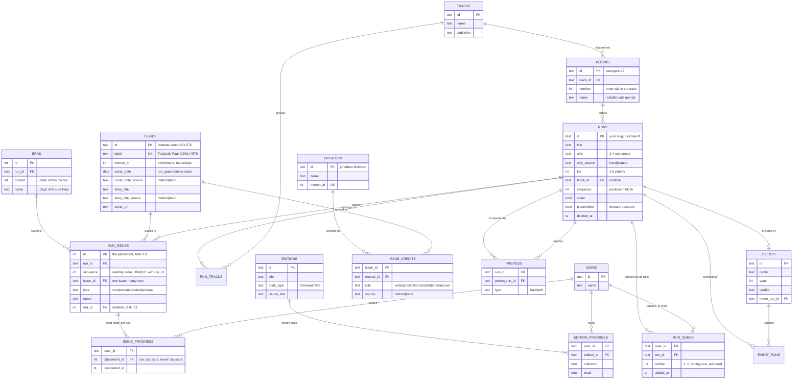

## 2. Books data model

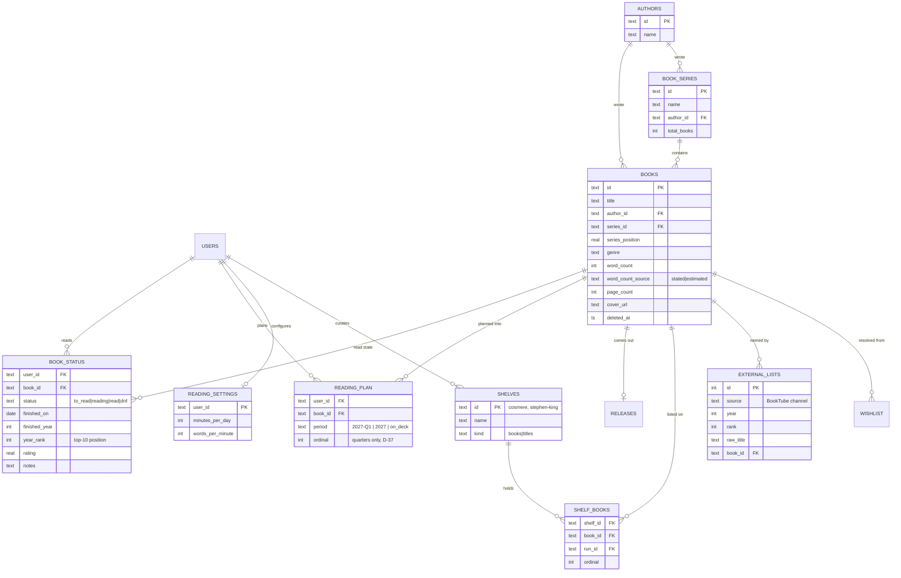

## 3. Derived layer — what the views compute

Nothing below is stored. Each box is a view in `etl/views.sql`, replacing a
formula column or tab from the workbook.

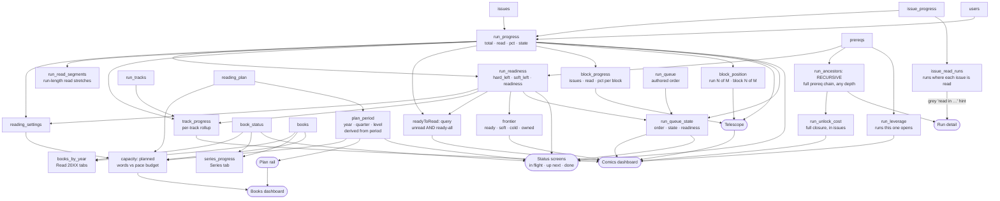

Read state is on the placement (ARCHITECTURE 2.14). `run_progress` and
`run_readiness` count a run's own placements. Block and track rollups count an
issue once, and count it read when any placement of it in scope is read.
`issue_read_runs` only drives a hint and never feeds a count.

## 3b. The telescope — three positions, no new tables

The comics dashboard shows where you are at three levels at once. Every number
it needs already exists; none of it is stored.

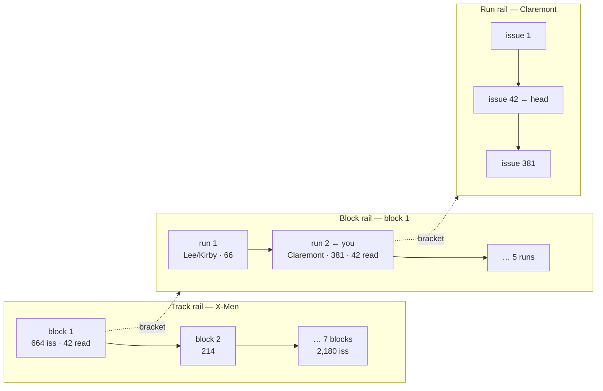

| Rail | Source | Query |
|---|---|---|
| Track: ordered blocks with issue and read counts | `block_progress` | `WHERE track_id = ? ORDER BY number` |
| Block: ordered runs with issue and read counts | `run_progress` ⋈ `block_position` | `WHERE block_id = ? ORDER BY run_ordinal` |
| Run: issue count, read count, head | `run_progress` + resume pointer (task 1.6) | one row |
| The ladder underneath | `block_position` | `run_ordinal / block_runs`, `block_ordinal / track_blocks` |

The rails run left to right and stack top to bottom, at every width (D-31); the
flowchart above shows their nesting, not their orientation. In the allocation
below, `H` is the rail's length, which is its width `W` (ARCHITECTURE §4).

The brackets are geometry, not data: each one connects the highlighted cell of
a coarser rail to the full extent of the next finer one. Runs with a null
`block_id` — nine of them — fall back to a two-rail view (`data-rails="2"`). The
only real work is a minimum legible cell height, so a 6-issue run beside a
381-issue one does not vanish. The allocation is one function, applied to every
rail (ARCHITECTURE §4 has the code):

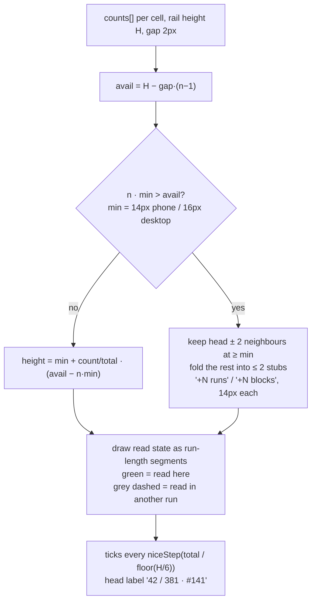

The rail is interactive: each cell is a focusable link, and each rail is a
slider that scrubs to `/comics/[runId]#p-[ordinal]`.

## 4. Run readiness state

Five states, all visible. Each has one badge, with a glyph as well as colour:

| State | Badge | Colour |
|---|---|---|
| `blocked` | `⊘ N runs first` | amber |
| `ready_hard` | `○ ready · N soft unread` | green outline |
| `ready_all` | `● ready` | green fill |
| `reading` | `◐ n / N` (no prerequisite badge alongside) | blue |
| `read` | `✓ read · date` | grey |

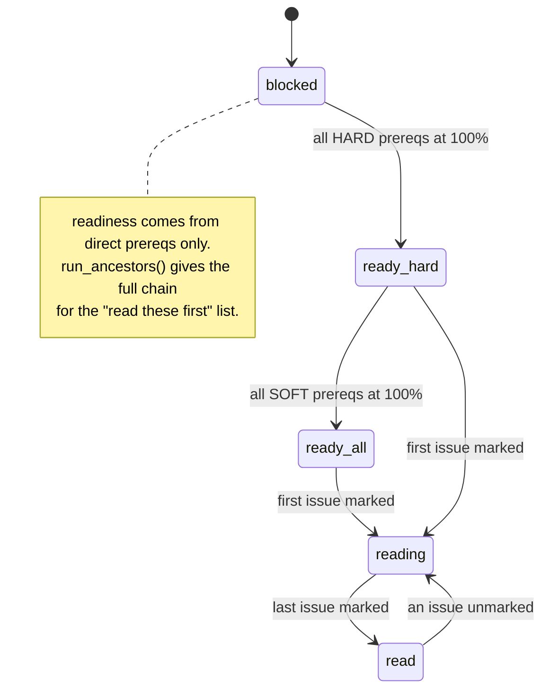

## 5. Runtime architecture

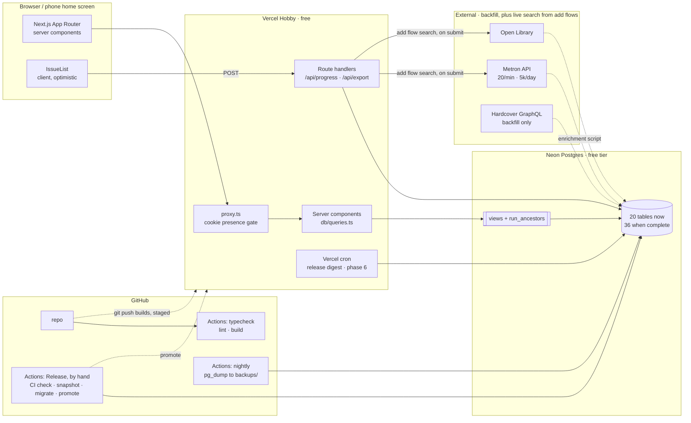

## 6. Bulk-entry validation pipeline

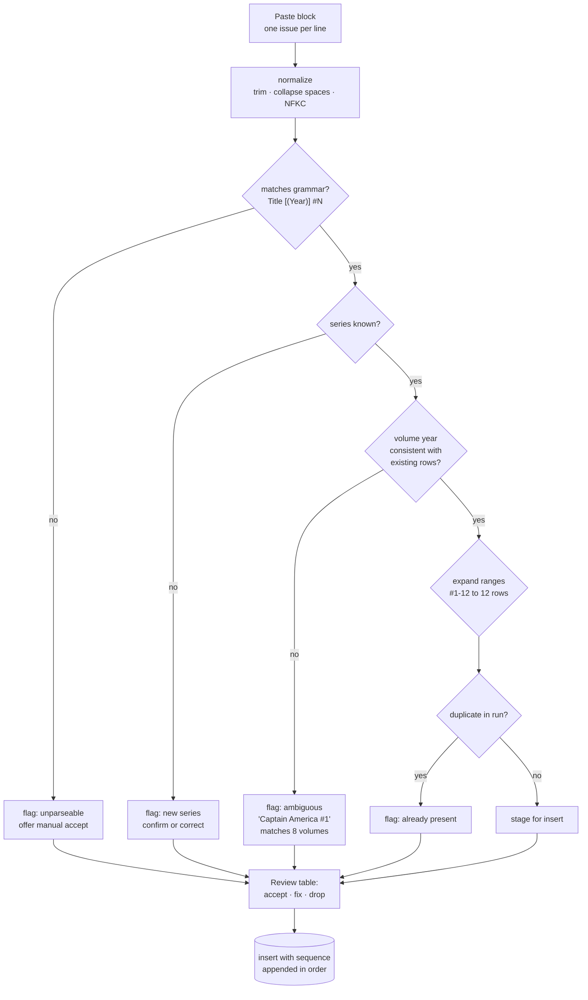

## 7. AI proposal flow (Phase 7)

The model never writes. It proposes; Metron verifies; you approve.

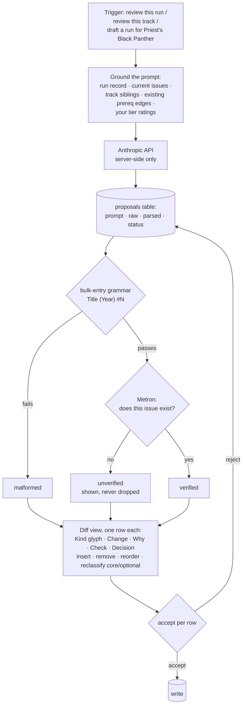

## 8. Watchlist data model

Three levels — franchise, title, season. Structurally this mirrors the comics
model in §1 (track → run → issue), minus the dependency graph. Episodes are
deliberately absent.

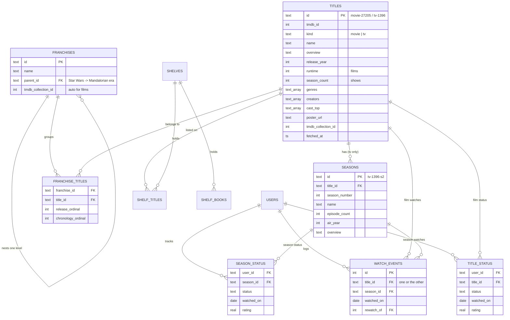

## 8b. Show state is derived, never stored

Exactly as run progress is derived from issues.

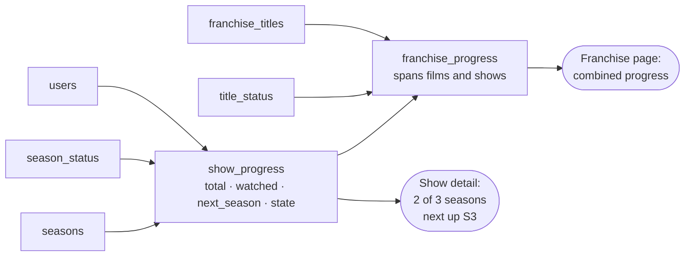

State machine per show:

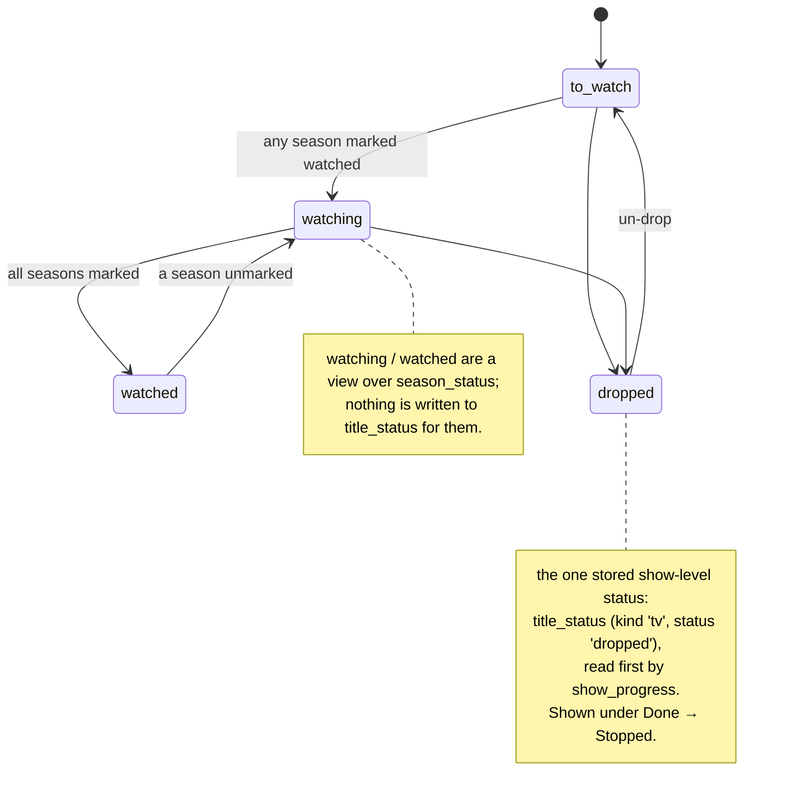

## 9. Where metadata comes from

The catalogue is authored by you for comics; fetched for everything else. The
split matters: no API knows that `Fantastic Four #570-588` plus `FF #1-23` is
one Hickman run.

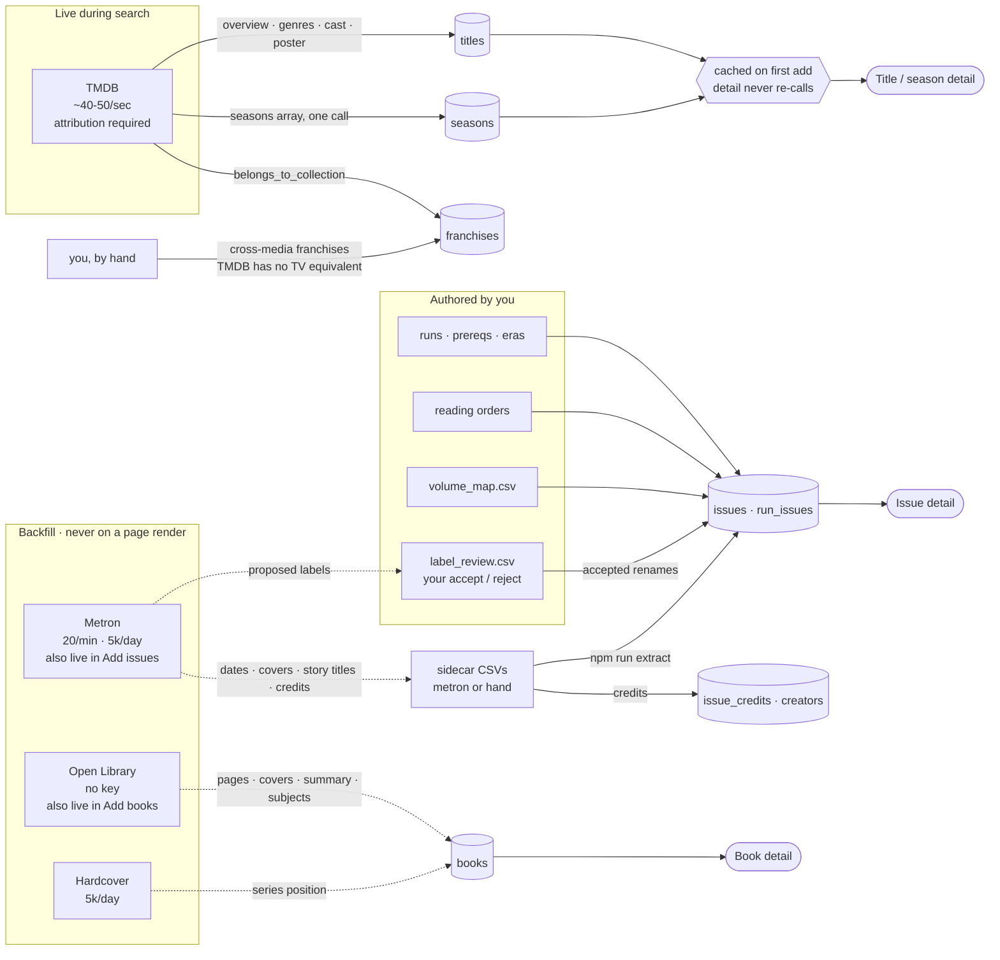

## 10. Add flow — search or type it, always a real row

ARCHITECTURE 2.15. The same shape for an issue into a run and a book into a
shelf or a to-read level: a quarter or year, On deck, or Someday (D-37; Someday
writes `book_status` only, no plan row).

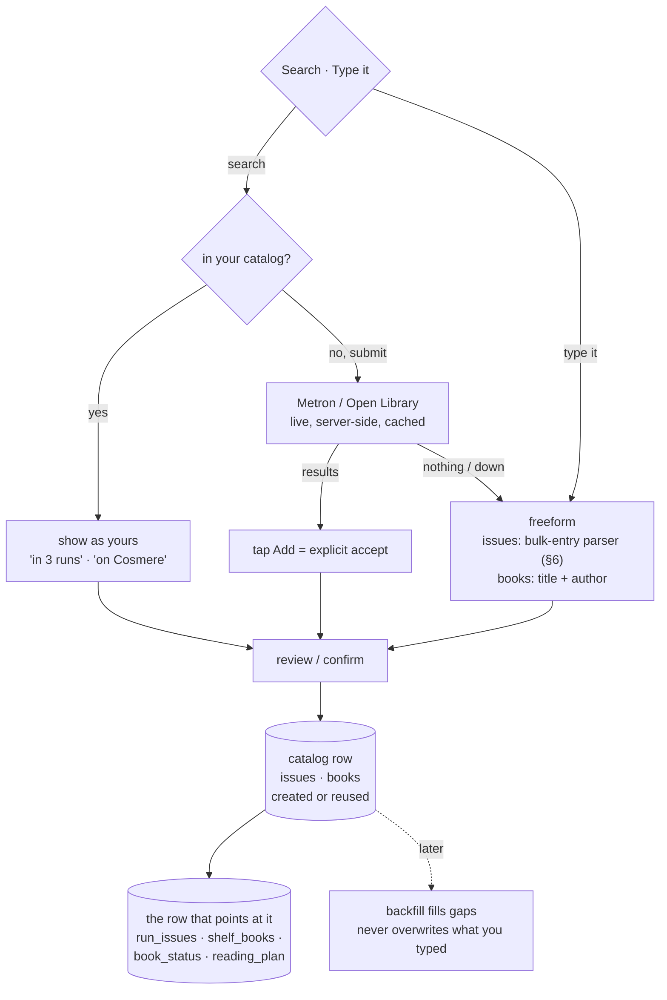
