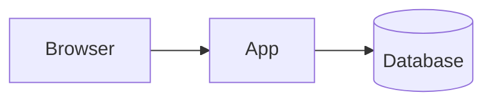

# Architecture: {{PROJECT_NAME}}

_Written by `/architecture`. Decisions live in `docs/decisions.md`; this doc describes the system they produce._

## 1. Overview

{{3-5 sentences plus a diagram: client, server, data, external services.}}

## 2. Stack

| Layer | Choice | Decision |
|---|---|---|
| Frontend | {{...}} | D-00x |
| Backend / API | {{...}} | D-00x |
| Database + migrations | {{...}} | D-00x |
| Auth | {{...}} | D-00x |
| Hosting / deploy | {{...}} | D-00x |
| Testing (unit / integration / e2e) | {{...}} | D-00x |

## 3. Data model

{{ER diagram (mermaid erDiagram) plus a table per entity: fields, types, keys, constraints, indexes. State what is stored vs. derived.}}

## 4. Components and boundaries

| Component | Responsibility | Talks to | Location in repo |
|---|---|---|---|
| {{...}} | | | |

## 5. API / data access

{{Routes, server actions, or queries per feature. Include auth and validation rules.}}

## 6. Feature traceability

| Feature | Screens | Components | Entities |
|---|---|---|---|
| F-01 | S-01 | {{...}} | {{...}} |

## 7. Non-functional requirements

| Area | Requirement (measurable) |
|---|---|
| Performance | {{e.g. p95 page load < 1.5 s on 4G for lists up to 1,000 rows}} |
| Availability | {{e.g. best effort; free-tier cold starts acceptable}} |
| Security | {{e.g. single-user auth; no public endpoints write data}} |
| Data safety | {{e.g. nightly backup, restore tested once}} |
| Accessibility | {{e.g. keyboard navigable; 44 px touch targets}} |

## 8. Testing strategy

| Level | Tool | Covers | Runs in |
|---|---|---|---|
| Unit | {{...}} | {{pure logic, derived values}} | verify.full, CI |
| Integration | {{...}} | {{queries, migrations against a real DB}} | CI |
| E2E smoke | {{...}} | {{5-10 core journeys}} | CI |

Seed data: {{where it lives and what it must contain so ACs can cite concrete values}}.

## 9. Walking skeleton spec

The thinnest end-to-end slice that proves the stack, built by `/skeleton`:

- {{e.g. one page lists rows from one table via the real data path}}
- {{scripts: dev, typecheck, lint, test, build, db:migrate, db:seed}}
- {{one unit test, one e2e smoke test}}
- {{CI green; deployed to {{host}} preview}}

## 10. Risks and spikes

| Risk | Impact | Mitigation / spike |
|---|---|---|
| {{...}} | | |
